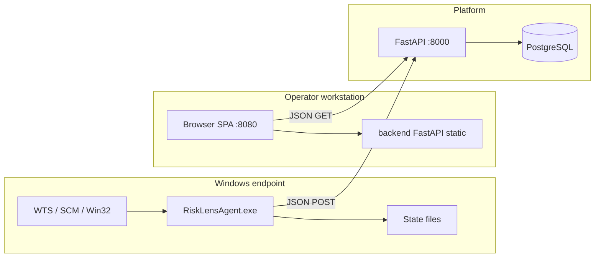

# 01 — Project Overview

## What RiskLens is

RiskLens is a computer-centric Windows endpoint monitoring platform. It is **not** a fork of Kibana, OpenVAS, or Elastic UI. The live product is:

1. A **Windows agent** (`agent/`) that installs as a service or runs in console mode, collects endpoint facts, and posts them to the Platform API.
2. A **Platform API** (`platform/`) — FastAPI + PostgreSQL — that registers agents, stores heartbeats and inventory, and exposes Fleet query APIs.
3. A **vanilla JS SPA** (`frontend/`) served by a small FastAPI static server (`backend/`) on port 8080.

The intended product model (Company → Groups → Computer → Session → Account / Application Activity / Browser Activity) is defined in [ARCHITECTURE.md](ARCHITECTURE.md). Groups and Browser Activity are **not implemented**. Session and Application Activity **are implemented**.

## Business goals (from the product architecture, as encoded in the UI and APIs)

- Give operators a **Fleet** of managed Windows computers, not an Elasticsearch dashboard clone.
- Show **presence** (online / warning / offline) from agent heartbeats.
- Store **inventory**: device hardware, local user accounts, installed applications.
- Store **runtime activity** bound to a Windows logon session: computer sessions and foreground application usage.
- Keep inventory (what is installed) separate from usage (what ran during a session).
- Reserve space for later security product surfaces (alerts, incidents, detections, response) without implementing them yet.

The root `README.md` still describes an Elasticsearch-backed Monitor/Ingest UI. That description is **stale**. The current frontend does not query Elasticsearch. `elasticsearch` appears only in the root `requirements.txt` and is unused by `platform/` and `backend/` application code.

## System goals (from the running architecture)

| Goal | How the code implements it |
|------|----------------------------|
| Durable agent identity | UUID v4 `agent_id` + `install_id` in `identity.json` |
| Registration | `POST /api/v1/agents/register` |
| Liveness | Heartbeat every 30s (configurable) → `POST /api/v1/agents/{id}/heartbeat` |
| Device inventory | One-shot at agent start → `POST /api/v1/devices` |
| Account inventory | Periodic (default 5m) → `POST /api/v1/users` |
| Software inventory | Periodic (default 15m) → `POST /api/v1/software` |
| Session + app activity | Periodic (default 15s) + WTS events → `POST /api/v1/sessions`, `POST /api/v1/applications` |
| Operator console | Fleet UI on `http://127.0.0.1:8080` calling Platform on `http://127.0.0.1:8000` |
| Persistence | PostgreSQL via SQLAlchemy + Alembic (memory backend exists for tests) |
| Clean HTTP errors | `ErrorEnvelope` JSON with `code`, `message`, `details`, `request_id` |

## Current implementation status

Baseline recorded in `docs/ARCHITECTURE.md`: **Sprint 13.7, frozen before Sprint 14**.

The code has moved past that freeze in one important way: **computer sessions and application activity are live** (agent collectors, APIs, tables, Fleet tabs). The frozen architecture document still labels those as reserved; this package documents the code.

### Live today

- Agent service skeleton, identity, configuration, transport, Windows SCM, Event Log
- Registration, device upload, heartbeat, users, software, activity modules
- Platform API with postgres and memory adapters
- Fleet list/detail, presence, policy assignment (default Windows policy), tags (schema only; no write API)
- Fleet detail tabs: Overview, Accounts, Installed Applications, Sessions, Application Activity, Health, Policies
- Reports → Account Inventory and Software Inventory pages
- Alembic migrations `0001`–`0007`

### Partial today

- Dashboard: four Fleet summary cards live; remaining panels are placeholders
- Health: heartbeat age and inventory timestamps live; CPU/memory/disk **usage** strings are `"Not implemented yet"`
- Session one-active-per-agent invariant: stated in domain comments and tests; **not enforced** on the production login write path (`SessionService` uses `_upsert_one` → `upsert_many` by `session_id` only)
- Agent retry: activity module has a local upload queue; other modules do not
- Dual HTTP servers (`backend/` vs `platform/`) instead of one process serving UI + API

### Not implemented

- Groups, Alerts, Incidents, Reports (except inventory links), Policies page, Administration, Settings
- Processes, services, network, browser activity, timeline events
- Global search (input disabled: “after Sprint 14”)
- Authentication, authorization, API keys, multi-tenancy
- Background workers, Redis, caching beyond `get_settings()` LRU
- Transport-level HTTP retry
- Elasticsearch integration in application code

See [14_CURRENT_STATUS.md](14_CURRENT_STATUS.md) for the full inventory.

## Future roadmap (from reserved code, not from speculation)

These are **explicitly reserved** in source:

| Reservation | Where it lives |
|-------------|----------------|
| Sprint 14 global search | `frontend/index.html` disabled search input |
| Company → Groups → Computers | `platform/app/domain/groups/`, Administration → Groups UI |
| Collectors: processes, services, event logs | Policy flags on `policies` table / `FleetPolicyResponse` (`collect_processes`, `collect_services`, `collect_event_logs`) |
| Browser activity | Empty domain package + Fleet Activity tab |
| Alerts, incidents, detections, response, rules, AI, reports, administration | Empty domain packages + unmounted API prefixes in `platform/app/api/router.py` |
| Timeline | `GET /api/v1/fleet/{id}/timeline` returns `{ "status": "Not implemented yet" }` |
| Config `security` / `update` YAML sections | Empty structs on the agent |
| `modules.enabled` and `performance.max_concurrency` | Loaded and validated; **not used** at runtime |

The next recommended engineering sprint is in [15_NEXT_SPRINT.md](15_NEXT_SPRINT.md).

## Technology stack

### Windows agent

| Piece | Choice in code |
|-------|----------------|
| Language | Go 1.23 (`agent/go.mod`) |
| Service | `golang.org/x/sys/windows/svc` |
| Config | YAML via `gopkg.in/yaml.v3` |
| HTTP | `net/http` only inside `internal/transport/client` |
| Logging | `log/slog` JSON file + optional console + Windows Event Log |
| Tests | `go test ./...` (`agent/Makefile`) |

### Platform API

| Piece | Choice in code |
|-------|----------------|
| Language | Python ≥ 3.13 (`platform/pyproject.toml`) |
| HTTP | FastAPI ≥ 0.115, Uvicorn |
| Validation | Pydantic v2 |
| ORM | SQLAlchemy 2.x |
| Migrations | Alembic (`0001`–`0007`) |
| Driver | `psycopg` 3 (`postgresql+psycopg://`) |
| Tests | pytest, pytest-asyncio, httpx |

### UI

| Piece | Choice in code |
|-------|----------------|
| Markup | Single `frontend/index.html` |
| Logic | Single `frontend/assets/app.js` (~1370 lines), no bundler |
| Style | Tailwind CDN + `frontend/assets/app.css` |
| Fonts | IBM Plex Sans / Mono (Google Fonts CDN) |
| UI server | FastAPI `backend/app/main.py` serving static files on port 8080 |

### Data stores

| Store | Used by | Status |
|-------|---------|--------|
| PostgreSQL `risklens` | Platform API (default) | **Implemented** |
| In-memory dicts | Platform tests / `RISKLENS_REPOSITORY_BACKEND=memory` | **Implemented** |
| SQLite `backend/data/risklens.db` | `backend/app/db.py` `identities` table | Created on UI-server startup; **no routes read or write it** |
| Elasticsearch | Root README / `requirements.txt` | **Not implemented** in application code |

## Design philosophy (observable in code)

1. **Computer-centric, not employee-centric.** Fleet rows are agents. Accounts are Windows identities (`username` + `sid`), not HR records.
2. **Hexagonal backend.** `api/` → `services/` → `repositories/` (ports) → `infrastructure/postgres` or `infrastructure/memory`. Domain packages have no FastAPI imports.
3. **Agent modules never import `net/http`.** They talk through `internal/transport/interfaces.Transport`.
4. **Fail closed on unknown agents.** Inventory/heartbeat/session posts return 404 `unknown_agent` if the agent is not registered.
5. **Closed sessions are immutable.** Domain function `session_is_immutable`; SQL `ON CONFLICT` skips rows with `status = 'closed'`.
6. **Presence is derived, not stored.** `agent_status.last_seen` is stored; online/warning/offline is computed at read time (`ONLINE_MAX_SECONDS = 60`, `STALE_MAX_SECONDS = 300`).
7. **Placeholders are first-class.** Empty domain packages and `"Not implemented yet"` responses are asserted by architecture tests (`test_sprint_13_5_architecture.py`, `test_sprint_13_6_architecture.py`).
8. **Sprint 12/13 public API contracts are frozen.** Tests named for Sprint 12 still require devices/users/software to work after Fleet was added.

## High-level architecture

Two processes must be running for the product UI:

- Platform: `platform/scripts/run_dev.ps1` or `uvicorn app.main:app --host 0.0.0.0 --port 8000`
- UI: `uvicorn backend.app.main:app --host 127.0.0.1 --port 8080` from the repo root

The agent is a third process on each managed Windows machine.

## Related documents

- Architecture diagrams: [02_SYSTEM_ARCHITECTURE.md](02_SYSTEM_ARCHITECTURE.md)
- Agent internals: [03_AGENT_ARCHITECTURE.md](03_AGENT_ARCHITECTURE.md)
- Platform internals: [04_BACKEND_ARCHITECTURE.md](04_BACKEND_ARCHITECTURE.md)
- Frozen product IA: [ARCHITECTURE.md](ARCHITECTURE.md)
