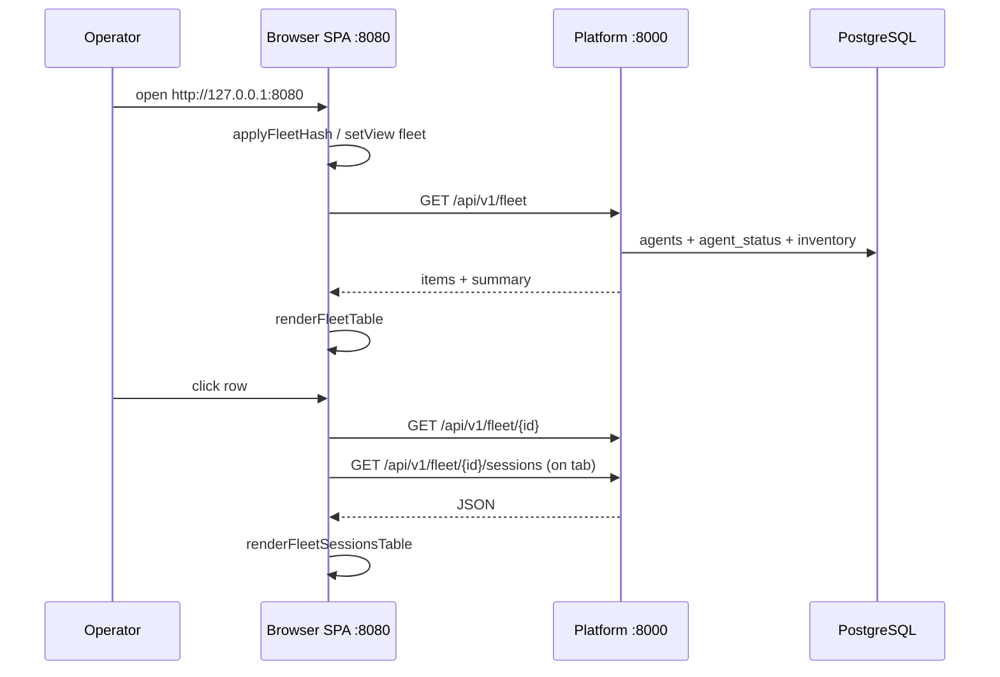

# 05 — Frontend Architecture

The operator UI is a single-page application with **three files** and **no build step**.

```
frontend/
  index.html
  assets/app.js      (~1370 lines)
  assets/app.css
```

It is served by `backend/app/main.py` on port **8080**. All live data is fetched from the Platform API on port **8000**. The 8080 process does not proxy API calls.

## Folder structure

| Path | Role |
|------|------|
| `frontend/index.html` | Document, Tailwind CDN, Google Fonts, all view markup, nav |
| `frontend/assets/app.js` | State, routing, `fetch`, renderers |
| `frontend/assets/app.css` | Nav, fleet tabs, presence badges, tables |
| `backend/app/main.py` | `GET /` → index.html; `/assets` static mount |
| `backend/app/config.py` | `metadata_db_path` only |
| `backend/app/db.py` | SQLite `identities` table — **unused by any route or by app.js** |

External CDNs (required for styling/fonts):

- `https://cdn.tailwindcss.com`
- Google Fonts IBM Plex Sans / Mono

Theme tokens in the inline Tailwind config: `ink`, `mist`, `signal`, `caution`, `critical`.

## Components

There is no component framework. “Components” are HTML sections plus JS render functions that write `innerHTML`.

Reusable CSS classes: `.nav-link`, `.stat-card`, `.panel`, `.device-row`, `.fleet-tab`, `.device-presence-*`.

`#error-banner` exists in HTML and is **never referenced in `app.js`**.

## Pages / views

View sections in `index.html`:

| Section ID | Nav | Default |
|------------|-----|---------|
| `view-dashboard` | Dashboard | hidden |
| `view-fleet` | Fleet | **visible** (landing) |
| `view-alerts` | Alerts | hidden |
| `view-incidents` | Incidents | hidden |
| `view-reports` | Reports | hidden |
| `view-policies` | Policies | hidden |
| `view-administration` | Administration | hidden |
| `view-settings` | Settings | hidden |
| `view-users` | via Reports → Account Inventory | hidden |
| `view-software` | via Reports → Software Inventory | hidden |
| `view-groups` | via Administration → Groups | hidden |
| `view-fleet-detail` | Fleet row / hash | hidden |

Root `README.md` Monitor/Ingest navigation **does not exist** in this HTML.

## Routing

Hybrid show/hide + hash:

- Sidebar `.nav-link[data-view]` calls `setView(view)` which toggles `.hidden` on `#view-{view}`.
- Fleet detail uses `window.location.hash`:
  - `#/fleet` → list
  - `#/fleet/{uuid}` → `loadFleetDetail`
- `hashchange` → `applyFleetHash()`
- `primaryNavView()` maps `fleet-detail` → Fleet highlight, `users`/`software` → Reports, `groups` → Administration

No History API paths. The static server has no SPA fallback routes other than `/`.

## State management

Single mutable object in `app.js`:

```javascript
state = {
  view: "fleet",
  fleet: {
    items, total, limit: 25, offset: 0, sort: "hostname",
    q, status, tag, loading, error,
    summary: { total_agents, online, offline, warning, never_seen, healthy },
    selectedId, tab: "overview",
    detail, detailLoading, detailError,
    users, software, sessions, applicationActivity, health, policy,
    extraLoading, extraError
  },
  users: { items, total, limit: 25, offset: 0, sort: "username", filters..., loading, error },
  software: { items, total, limit: 25, offset: 0, sort: "application_name", filters..., loading, error }
}
```

No Redux/Vue. No localStorage.

Tab cache on fleet detail:

- users, sessions, applications, health, policy: fetch once per selected agent
- software: **refetched every time** the tab is opened (asserted by `test_frontend_fleet.py`)

## API integration

```javascript
window.RISKLENS_PLATFORM_API = window.RISKLENS_PLATFORM_API || "http://127.0.0.1:8000";
const PLATFORM_API_BASE = String(window.RISKLENS_PLATFORM_API || "http://127.0.0.1:8000").replace(/\/$/, "");
API_TIMEOUT_MS = 10000
```

`platformUrl(path, params)` builds the URL. `fetchJson` uses `fetch` + `AbortController`. `parseApiError` reads the Platform `ErrorEnvelope`.

Override the API host by setting `window.RISKLENS_PLATFORM_API` **before** `app.js` loads.

CORS: Platform `RISKLENS_CORS_ORIGINS` must include `http://127.0.0.1:8080` and `http://localhost:8080`.

### Endpoints the SPA calls

| Call | Path |
|------|------|
| Fleet list + summary | `GET /api/v1/fleet` |
| Endpoint overview | `GET /api/v1/fleet/{id}` |
| Accounts | `GET /api/v1/fleet/{id}/users` |
| Installed applications | `GET /api/v1/fleet/{id}/software` |
| Sessions | `GET /api/v1/fleet/{id}/sessions` |
| Application activity | `GET /api/v1/fleet/{id}/applications` |
| Health | `GET /api/v1/fleet/{id}/health` |
| Policy | `GET /api/v1/fleet/{id}/policy` |
| Account inventory page | `GET /api/v1/users` |
| Software inventory page | `GET /api/v1/software` |

Not called: devices API, top-level sessions/applications GET, timeline, `/health`.

## Rendering

Renderers write HTML strings with `escapeHtml`. Presence:

| `online_status` | Badge |
|-----------------|-------|
| `online` | 🟢 Online |
| `warning` | 🟡 Warning |
| `never_seen` | Never seen |
| other | 🔴 Offline |

`formatTime`, `formatBytes`, `formatNumber` format API fields.

Empty/error states use `.device-empty` / `.device-error`.

## Polling

There is **no periodic Fleet poll**. Presence goes stale until the operator reloads or re-opens Fleet.

The only timer: `startSessionDurationTicker()` — `setInterval(1000)` updates `[data-session-duration-live]` cells on the Sessions tab for ACTIVE sessions.

## Fleet page

Filters: `q`, `status` (`online|warning|offline|never_seen|healthy`), `tag`. Pagination `limit` 25. Sortable columns via `.fleet-sort`.

Table columns:

| Column | Live field | Notes |
|--------|------------|-------|
| Hostname | `hostname` / `machine_name` | sortable |
| Current Account | `current_user` | sortable |
| OS | `operating_system` | sortable |
| Status | `online_status` | sortable |
| Last Seen | `last_seen` | sortable |
| Policy | `policy_name` | sortable |
| Group | — | always `"—"` |
| Tags | `tags` | joined |

Summary cards bind `fleet-card-*` and dashboard `dash-card-*` from `payload.summary`.

## Endpoint page (Fleet detail)

Hash `#/fleet/{agent_id}`. Header uses hostname/machine name.

### Inventory tabs

| `data-tab` | Status |
|------------|--------|
| `overview` | **Live** — hardware + presence from `GET /api/v1/fleet/{id}` |
| `accounts` | **Live** — `GET .../users` |
| `software` | **Live** — `GET .../software` |
| `processes` | Stub — `"Not implemented yet"` |
| `services` | Stub — `"Not implemented yet"` |
| `network` | Stub — definition list `"Not collected yet"` |
| `policies` | **Live** — `GET .../policy` |
| `health` | **Live** — `GET .../health` (usage fields may be `"Not implemented yet"`) |

### Activity tabs

| `data-tab` | Status |
|------------|--------|
| `sessions` | **Live** — login/logout/duration/status |
| `applications` | **Live** — foreground usage rows |
| `browser` | Stub |
| `timeline` | Stub — `renderTimelinePlaceholders()` hardcoded event names, status `"placeholder"` |

### Security tabs

`alerts`, `detections`, `response`, `threat-timeline` — stub.

Dead JS: `f.tab === "activity"` → `renderActivityArchitecture()` but **no HTML tab** has `data-tab="activity"`.

## Sessions page

There is **no standalone Sessions route**. Sessions are the Fleet detail tab `sessions`.

`GET /api/v1/fleet/{id}/sessions` triggers backend offline reconciliation if the agent is offline.

Live duration ticker runs only while that table is shown.

## Inventory pages

### Account Inventory (`view-users`)

`GET /api/v1/users` with filters username, account_type, enabled. Sort/pagination live.

Columns Current User, Department, Group are always `"—"`.

### Software Inventory (`view-software`)

`GET /api/v1/software` with name/publisher/version/architecture filters.

Current User column always `"—"`.

### Installed Applications (endpoint tab)

Same software API scoped to one agent via `GET /api/v1/fleet/{id}/software`.

## Applications page

No standalone page. Fleet detail tab `applications` uses `GET /api/v1/fleet/{id}/applications`.

## Dashboard

Four cards (Fleet Summary, Online, Offline, Warning) filled when `loadFleet()` runs.

Placeholder panels: Compliance, Recent Activity, Alerts, Top Applications, Top Installed Applications, Policy Status — `"Not implemented yet."`

## How data flows



## Placeholder / disabled UI

- Global search: disabled, placeholder `"Global search will be enabled after Sprint 14."`
- Alerts, Incidents, Policies, Settings, Groups, most Reports/Admin cards: `"Not implemented yet."`

## Related documents

- Inventory/collector matrix: [09_INVENTORY.md](09_INVENTORY.md)
- API: [07_API_REFERENCE.md](07_API_REFERENCE.md)
- Frozen IA: [ARCHITECTURE.md](ARCHITECTURE.md)
