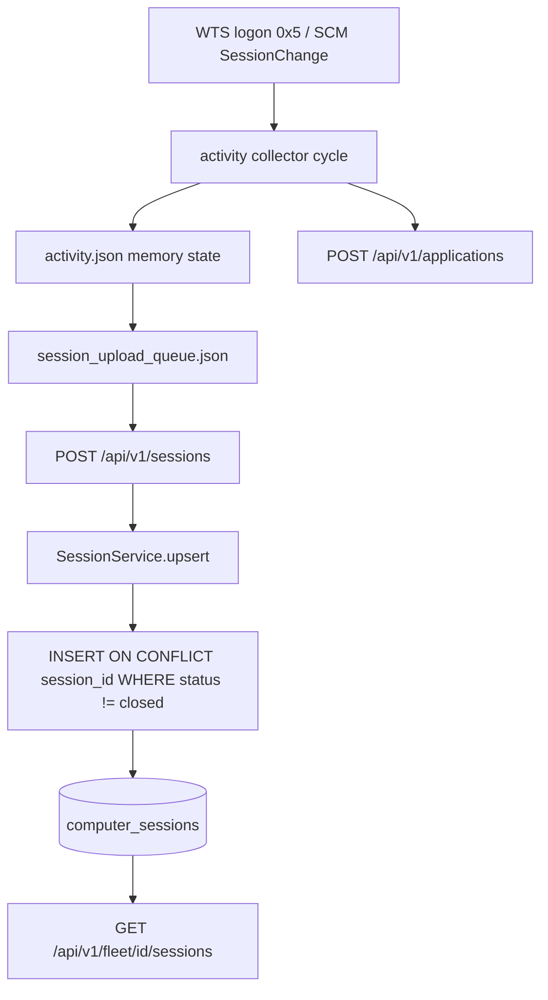
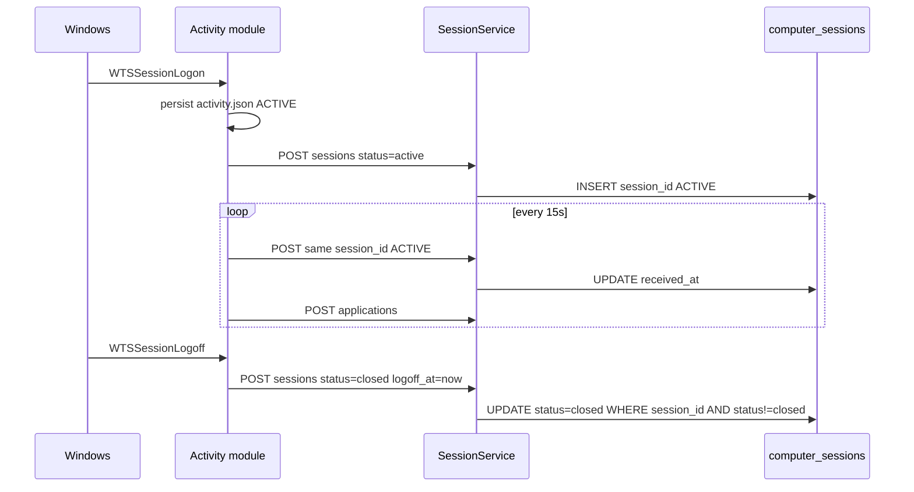

# 08 — Agent Session Lifecycle

This document describes the **implemented** session pipeline from Windows logon through Platform persistence, including shutdown, logout, offline close, and the remaining production gap.

Official product rules (operator intent captured in domain comments and tests):

- A session begins at a real Windows logon.
- Logout priority: (1) `WTS_SESSION_LOGOFF` / terminate (2) shutdown/restart (3) next Windows logon only if the previous row is still ACTIVE (4) offline `last_seen` last resort.
- Once `status=closed`, logout time, duration, and status are immutable.
- The agent keeps exactly one **current** session in `activity.json`.
- `count(active_sessions(agent_id)) <= 1` is the intended backend invariant.

**Current production write path does not enforce the last invariant.** Login uses `_upsert_one` → `upsert_many` keyed only by `session_id`. `SessionRepository.activate_current` exists and is unit-tested, but `SessionService` does not call it.

---

## Pipeline



---

## 1. Windows Login

**Sources** (`agent/internal/modules/activity/lifecycle.go`):

- WTS `WTSSessionLogon` (0x5) from SCM or the hidden WTS window
- Remote/console connect also call `cycleNow()` without the LOGIN DETECTED banner

On logon the agent logs `LOGIN DETECTED`, dumps `activity.json` / in-memory `session_id`, then `cycleNow()`.

**Collector** (`collector_windows.go` + `lifecycle` step in `upload.go` / `state.go`):

- Reads the live WTS session (session id, username, SID, logon time)
- Builds `session_id` = UUID v5(namespace, `agentID:wtsSessionID:logonAt`)
- If `activity.json` already holds a **different** open session, the step result may include a **closed** previous session plus the new **active** session (`LOGIN_CLOSE_THEN_OPEN`)
- If there is no local previous session, payload is open-only (`OPEN_ONLY_NO_LOCAL_PREVIOUS`)

Local files updated: `activity.json` (current session), optional queue on upload failure.

REPRO logs record previous vs current `session_id` and the JSON POST body kind:

- `SHUTDOWN`
- `HEARTBEAT_OR_LOGIN_OPEN`
- `LOGIN_CLOSE_THEN_OPEN`
- `EMPTY`

**Important:** If the previous session was never stored locally (agent not running at last logon, or `activity.json` missing), the agent **cannot** POST a close for that previous `session_id`. Closing then depends on backend login/offline logic.

---

## 2. Session creation (backend)

`POST /api/v1/sessions` → `SessionService.upsert`.

Classification:

1. Unknown agent → 404
2. Split items into closed vs opened
3. **Only closed items** → shutdown path `_close_current_session`
4. Otherwise: upsert each closed item, then each opened item via `_activate_login`

`_is_login` / `_activate_login`:

- Login = incoming `session_id` is **new** (no row) and not the current ACTIVE id
- Session heartbeat = same `session_id` as current ACTIVE

Both login and heartbeat call `_upsert_one` → `upsert_many([merged])`.

`merge_session` (`domain/sessions/entity.py`):

- New row → insert as sent
- Existing closed / `logoff_at` set → **return existing unchanged**
- Incoming closed → close ACTIVE, keep original `logon_at`, cap `logoff_at`
- Incoming active → keep original `logon_at`, `logoff_at=None`, status ACTIVE

SQL:

```sql
INSERT INTO computer_sessions (...) VALUES (...)
ON CONFLICT (session_id) DO UPDATE SET ...
WHERE computer_sessions.status != 'closed'
```

This does **not** `UPDATE ... SET status=closed` on **other** ACTIVE rows.

If a new login arrives while another session is still ACTIVE, the database can contain **two ACTIVE rows**. REPRO `dump_query` logs `TWO OR MORE ACTIVE SESSIONS PRESENT` and does **not** abort. `MultipleActiveSessionsError` is unused here.

---

## 3. Heartbeat (session keep-alive)

Every activity interval (default 15s) the collector observes the same WTS session and POSTs `status: active` for the same `session_id`.

This is not the agent **liveness** heartbeat (`POST /api/v1/agents/{id}/heartbeat`, 30s). That payload has no session fields.

Session heartbeats refresh `collected_at` / `received_at` on the ACTIVE row. They must not change `logon_at` (merge keeps original).

---

## 4. Application activity

Same activity cycle:

- Foreground window → `LiveApp`
- On app switch, previous segment gets `stopped_at` + `duration_seconds`
- `POST /api/v1/applications`
- Backend requires `session_id` to exist (`unknown_session` 422)

Application rows do not close computer sessions.

---

## 5. Shutdown

Windows:

- SCM Shutdown / PreShutdown → `OnWindowsShutdown` (4–8s timeout)
- `CTRL_SHUTDOWN_EVENT`
- `WM_ENDSESSION`

Agent:

1. `recordEvent("shutdown")`
2. `CloseSession("shutdown")` → `FlushClose`
3. Set `closing` so normal `cycle` is blocked
4. Drain queue
5. `persistCloseBestEffort` — mark local session closed, enqueue closed payload
6. Drain queue again

POST body is closed-only → backend **SHUTDOWN** path:

- Choose closed item with max `logon_at`
- Log errors (do not raise) if >1 ACTIVE, >1 closed in payload, or shutdown id ≠ backend ACTIVE
- `_upsert_one` **only that** `session_id`

Shutdown must not patch other sessions. That matches the “update only `current_session_id`” rule **when the agent’s current id matches**. If two ACTIVE rows already exist, shutdown closes one and can leave the other ACTIVE.

---

## 6. Logout (logoff)

Windows:

- `WTSSessionLogoff` (0x6)
- `WTSSessionTerminate` (0xB) mapped to logoff
- `CTRL_LOGOFF_EVENT`

Agent: `CloseSession(name)` with 8s timeout — same flush as shutdown.

If the process is killed before flush (console agent dying on logoff without the logoff hook succeeding), **no close POST** is sent. The local file may still show an open session, or the process is gone.

Backend close of a non-current session when a later `logon_at` exists is **CLOSE REJECTED** (`session_service._upsert_one`) unless the incoming `logoff_at` equals that next logon (the intended next-login close).

---

## 7. Offline

Presence: last heartbeat age > 300s → Fleet `offline`.

`FleetService` then calls `SessionService.close_open_for_agent(agent_id, last_seen)`:

- Load all sessions for the agent
- Require **exactly one** non-immutable (ACTIVE) session
- That session must be the latest `logon_at`
- Else log `OFFLINE RECONCILIATION REFUSED` and return 0
- Else `merge_fallback_close` at `last_seen`, `upsert_many`

This is last-resort. It will **not** run if two ACTIVE rows already exist — which is exactly the overlapping-session failure mode.

Listing `GET /api/v1/fleet/{id}/sessions` also triggers this when the agent is offline.

---

## 8. Recovery

Agent start:

- Load `activity.json`
- Drain `session_upload_queue.json`
- **Must not** `FlushClose` (restart ≠ logout)
- Next cycle resumes the open session or detects a new WTS logon

If Windows logged on while the agent was stopped, the first cycle looks like a new login from the collector’s point of view. Whether the previous DB row is closed depends on:

1. Local previous session in `activity.json` (agent can POST close+open)
2. Backend login path (currently does **not** close other actives)
3. Offline close (only if exactly one ACTIVE remains)

---

## Sequence (happy path)



---

## Current implementation (code facts)

| Layer | What it does |
|-------|----------------|
| Agent local state | One current session in `activity.json` |
| Agent login cycle | Can emit close of **local** previous + open of new |
| Agent shutdown/logoff | Flush closed payload for current local session |
| Agent queue | Retry failed POSTs (max 32) |
| Domain merge | Never mutate closed rows |
| SQL upsert | Per `session_id` only |
| `activate_current` | Repo method: close other actives + insert; **not used by SessionService** |
| Offline close | Single ACTIVE only; refused otherwise |
| REPRO logs | Agent + API + SQL rows_affected; dump after login/shutdown |
| Tests | `test_session_lifecycle.py` includes observed overlapping timeline regressions |

---

## Remaining issues (from code + observed behaviour)

1. **Two ACTIVE rows can exist.** Login does not close other ACTIVE sessions in the same transaction. Fleet can show overlapping closed/open times after later offline/shutdown stamps.
2. **Offline close refuses** when multiple ACTIVE rows exist, so the fallback cannot repair the overlap.
3. **Missed logout** (agent not running at logoff, flush timeout, console process death) leaves an ACTIVE row. A later login with a new `session_id` inserts a second ACTIVE row.
4. **`MultipleActiveSessionsError` unused** — REPRO logs only.
5. **`close_active_for_agent` unused** by the service.
6. **No unique partial index** `UNIQUE (agent_id) WHERE status = 'active'`.
7. **Architecture freeze vs code:** `docs/ARCHITECTURE.md` still calls sessions reserved; they are live.
8. **REPRO instrumentation** is still on the production path (noisy logs; required until the overlap is traced on Laptop B).
9. Agent must be **rebuilt/redeployed** for REPRO agent logs; backend restart is enough for API logs.

Do not treat shutdown as the root cause of overlap: shutdown only closes `current_session_id`. Overlap is created on the **login insert** path when a previous ACTIVE row was never closed.

---

## Related documents

- Agent activity package: [03_AGENT_ARCHITECTURE.md](03_AGENT_ARCHITECTURE.md)
- Table: [06_DATABASE.md](06_DATABASE.md)
- Sequences: [13_SEQUENCE_DIAGRAMS.md](13_SEQUENCE_DIAGRAMS.md)
- Status: [14_CURRENT_STATUS.md](14_CURRENT_STATUS.md)
