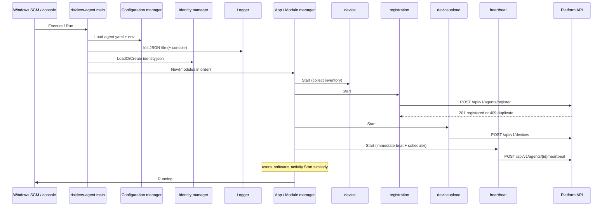
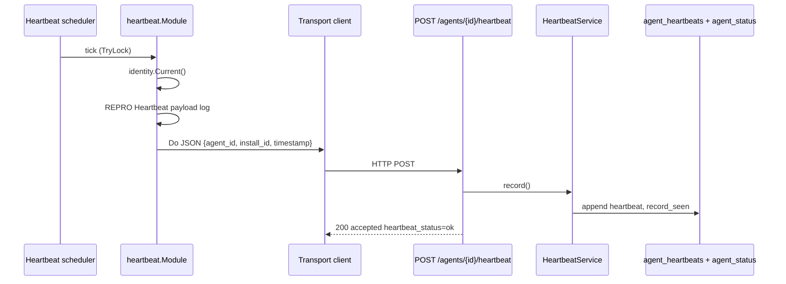
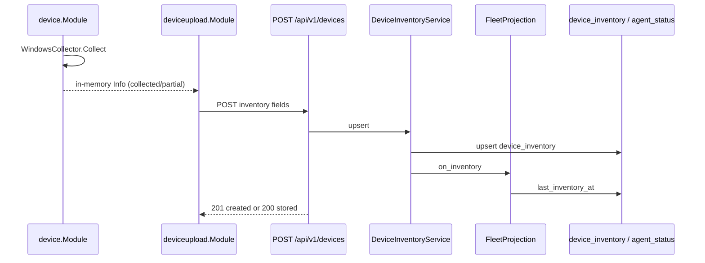
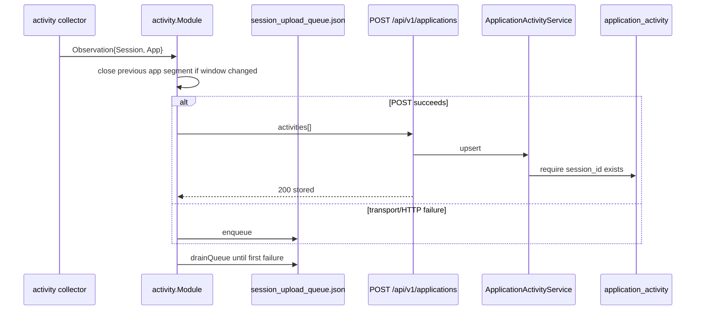
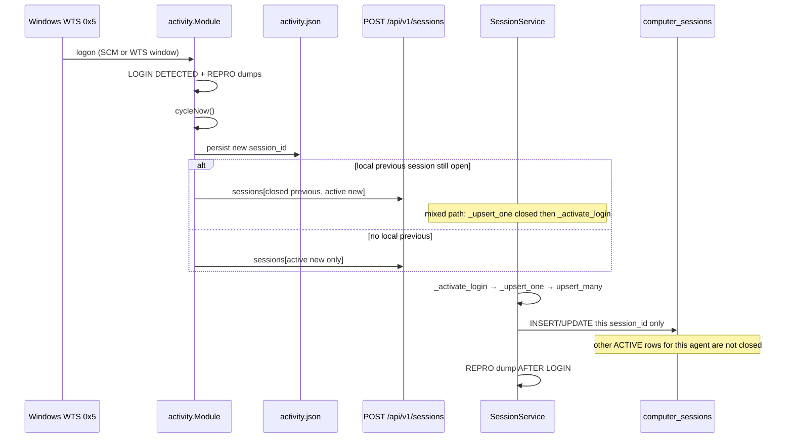
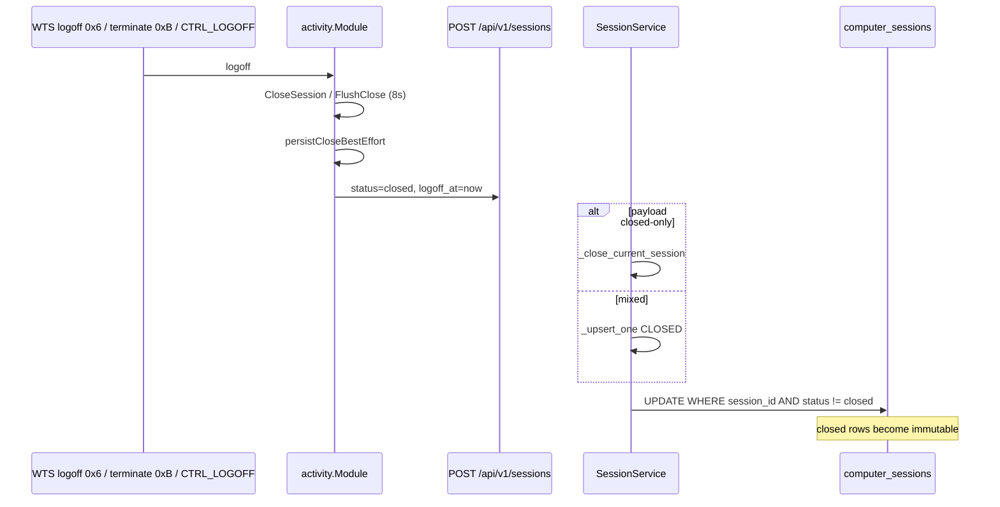
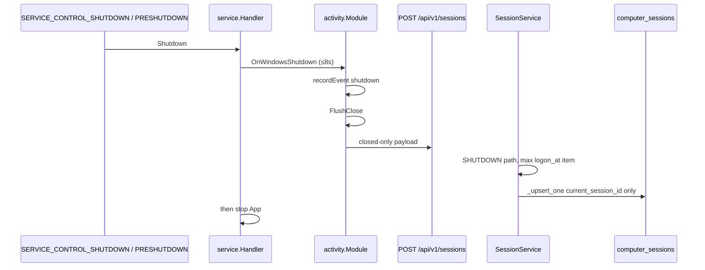
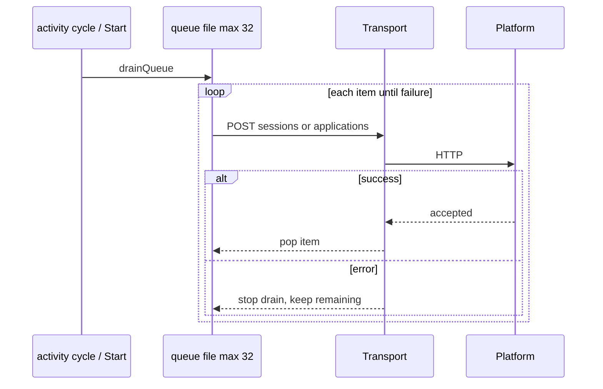
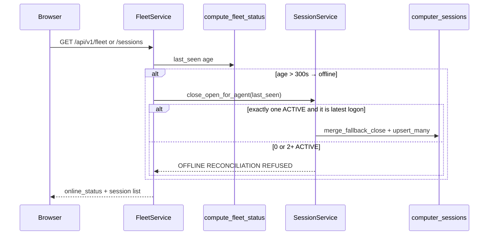

# 13 — Sequence Diagrams

All diagrams reflect **current source**, including the login write path that does not call `activate_current`.

---

## Agent startup

Misconfigured modules are skipped. Collection/upload failures mark the module failed; the process stays up.

---

## Heartbeat (liveness)

No HTTP retry. Next tick retries. Inflight skip if previous tick still running.

---

## Inventory upload (device)

Users/software follow the same shape with their own POST paths and schedulers (5m / 15m). They have **no** disk queue.

---

## Application upload

Unknown `session_id` → 422 `unknown_session` (not queued specially).

---

## Login

---

## Logout

If the process dies before POST, no logout is stored.

---

## Shutdown

---

## Retry (activity queue)

Registration/device/heartbeat/users/software: **no** this queue.

---

## Offline recovery

Agent-side recovery on process start: load `activity.json`, drain queue, **do not** FlushClose, then resume cycles.
