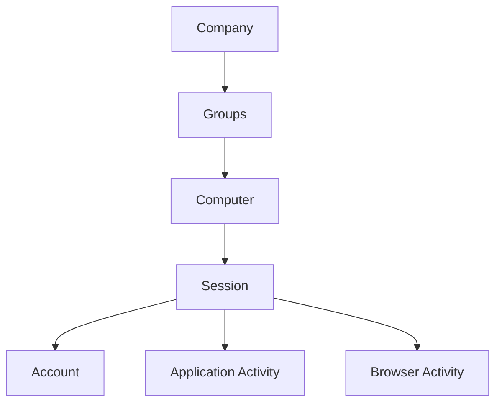
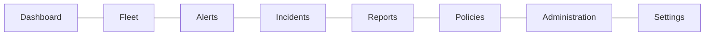
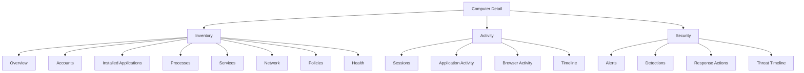
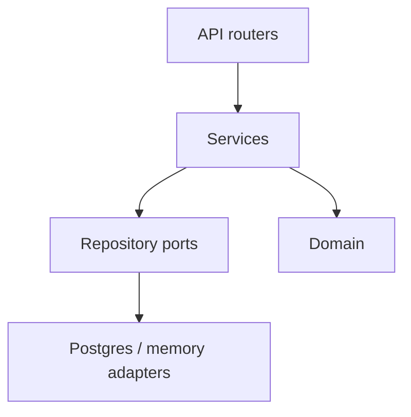

# RiskLens Official Architecture

**Baseline:** Sprint 13.7  
**Status:** Frozen before Sprint 14  

This document is the official information architecture for RiskLens. Later sprints add collectors and APIs inside this structure. They do not invent a parallel product model.

Sprint 12 inventory APIs and Sprint 13 Fleet APIs remain the live contracts. This document does not change them.

## Product model

RiskLens is a computer-centric endpoint platform.



Rules:

- Every managed endpoint is a Computer in Fleet.
- Groups organize computers. Groups are reserved; they are not implemented.
- Activity belongs to a Session on a Computer, not to the company as a whole.
- A Session is used by an Account (a Windows identity, not an employee record).
- Application Activity is runtime usage during a session.
- Installed Applications is inventory of what is installed. It is not usage.

## Company navigation



Fleet is the operational center. Default landing is Fleet.

Inventory pages are not primary navigation:

- Reports → Account Inventory → `GET /api/v1/users`
- Reports → Software Inventory → `GET /api/v1/software`
- Administration → Groups (reserved)

## Computer Detail

Tabs are grouped. Placeholders have no collectors.



Live today: Overview, Accounts, Installed Applications, Policies (read-only), Health.

Accounts still reads `GET /api/v1/fleet/{id}/users`.  
Installed Applications still reads `GET /api/v1/fleet/{id}/software`.

## Session architecture

Do not implement sessions until a later sprint. The model is:

Computer → Session → Account → Application Activity / Browser Activity

```text
Computer
  → Session
      → Account
      → Application Activity
      → Browser Activity
```

A session is one period of use on one computer. Application Activity and Browser Activity attach to that session. They do not attach to the company Dashboard first.

Reserved package: `app.domain.sessions` (empty). No session API. No session table.

## Terminology

| UI term | Meaning | API / table |
|---|---|---|
| Accounts | Windows identities on a computer | `/api/v1/users`, `user_inventory` |
| Installed Applications | Installed software inventory | `/api/v1/software`, `software_inventory` |
| Application Activity | Runtime usage during a session | reserved |
| Browser Activity | Website usage during a session | reserved |
| Sessions | Period of use on a computer | reserved |

Do not rename APIs or tables to match UI labels.

## Backend layers



Active domains: `agent`, `device`, `heartbeat`, `user`, `software`, `fleet`.

Reserved domains: `activity`, `browser`, `network`, `alerts`, `incidents`, `rules`, `timeline`, `reports`, `ai`, `groups`, `administration`.

New features add `domain → repository → service → api/v1` under the reserved name. Do not mount empty routers.

## Live API contracts

Unchanged:

- `POST/GET /api/v1/agents/register` and heartbeats
- `POST/GET /api/v1/devices`
- `POST/GET /api/v1/users`
- `POST/GET /api/v1/software`
- `GET /api/v1/fleet` and Fleet detail/users/software/health/policy/timeline

Backend layer notes remain in `platform/docs/architecture.md`.
