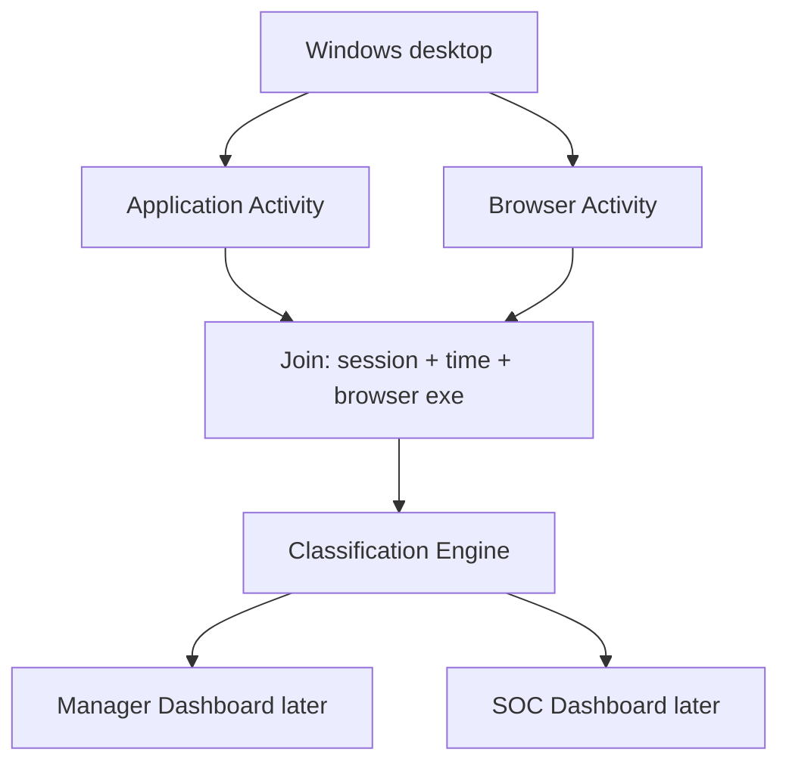
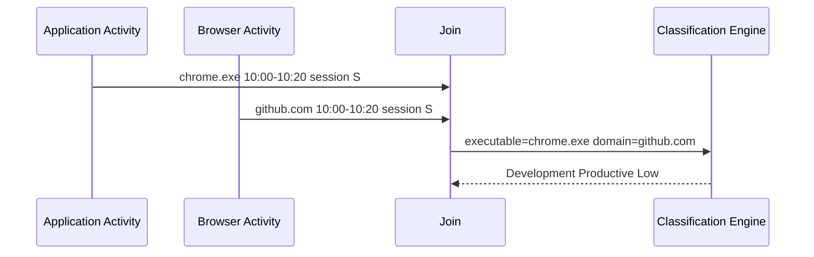

# Browser Activity — architecture

**Date:** 2026-08-21.  
**Status:** Design only. Do not implement.  
**Does not change:** Classification Engine, Application Activity, Device, Accounts, Installed Applications, Processes, Services, Network, Policies, Health, agent code, database, APIs, UI.

**Depends on (already approved):** [PRODUCTIVITY_CLASSIFICATION_V2.md](PRODUCTIVITY_CLASSIFICATION_V2.md), Classification Engine Phase 1 (`ClassificationInput.executable` + optional `browser_domain`).

---

## Purpose

Browser Activity **enriches** Application Activity. It does not replace it.

| Stream | Role |
|---|---|
| Application Activity | **Clock.** Foreground process, window title, `started_at` / `stopped_at`, seconds |
| Browser Activity | **Label.** Active tab of a **foreground** browser: host (and tightly limited extras) |

`chrome.exe` from 10:00–10:20 is twenty minutes of application time whether or not a URL is known. If the active tab is `github.com`, classification becomes Development / Productive. If there is no browser record, classification stays Browser / Neutral.

Do **not** add browser seconds to application seconds. One hour in Chrome on GitHub is one hour, not two.

---

## Current state (honest)

| Piece | Today |
|---|---|
| Application Activity | Live. `GetForegroundWindow` → exe + title, ~15s, `POST /api/v1/applications` |
| Browser Activity | Stub Fleet tab. No collector, API, or table |
| Classification Engine | Domain module. Accepts optional `browser_domain`. Not wired to ingest |

Window title is **not** Browser Activity. Titles are truncated, localized, and often omit the registrable domain. Classification must not parse titles as URLs.

---

## Pipeline



The join produces `ClassificationInput(executable, browser_domain)`. Time still comes from the application interval.

---

## 1. How browser activity should be collected

### Supported browsers (v1)

| Browser | Process (typical) | Collection channel |
|---|---|---|
| Google Chrome | `chrome.exe` | Chromium MV3 extension + Native Messaging to the RiskLens agent |
| Microsoft Edge | `msedge.exe` | Same MV3 extension (Chromium) + Native Messaging |
| Mozilla Firefox | `firefox.exe` | WebExtension + Native Messaging |

One extension codebase for Chrome and Edge. A Firefox variant with the same message contract.

### Recommended collection design

**Primary: event-driven extension in the user session, not OS-wide history scraping.**

1. GPO / Intune / Firefox policy installs and pins the extension (enterprise, not a user Chrome Web Store hop in production).  
2. The extension may read **only** the **active tab** of the **focused browser window** (`tabs` permission limited by using `tabs.query({ active: true, lastFocusedWindow: true })` and `tabs.onActivated` / `windows.onFocusChanged`).  
3. It sends `{ host, url_stripped, title, profile, incognito, window_id, tab_id, at }` to the agent over Native Messaging.  
4. The agent **drops** the sample unless Application Activity says the foreground executable is that browser (same WTS session). Background Chrome with GitHub open while the user is in Excel must emit **nothing**.  
5. Upload is a separate payload (future `POST /api/v1/browser` or nested on the activity cycle). It must share `session_id` and timestamps with Application Activity.

The agent remains the only process that talks to the Platform API. The extension never holds company classification mappings.

### Why not other techniques

| Technique | Verdict |
|---|---|
| Chrome/Edge/Firefox **history SQLite** | Not the active tab. Lock contention. Over-collection. Do not use for classification |
| Remote debugging (CDP / `--remote-debugging-port`) | Attack surface. Do not enable on employee browsers |
| UI Automation of the address bar | Fragile across locales and UI versions. Acceptable only as a documented fallback if the extension is blocked, not as v1 |
| Injecting into the browser process | AV/EDR hostility. Out of scope |
| Packet capture | Disproportionate. TLS. Do not use for this feature |

### Session 0 / SYSTEM

The Windows agent already cannot see the interactive desktop from Session 0; Application Activity uses impersonation / `--activity-foreground`. Browser collection must run **in the logged-on user session** (the extension already does). Native Messaging host must be registered per-user or via HKLM in a way that the interactive user can launch it.

---

## 2. What information should be collected

Collect the **minimum** needed to label a foreground browser interval and to join it.

| Field | v1 | Why |
|---|---|---|
| **Domain (host)** | **Required** | Classification Engine `browser_domain` |
| **URL (stripped)** | Optional store | Fleet drill-down; **not** used as the classification key |
| **Page title** | Optional | Operator context; already similar to `window_title` |
| **Browser executable** | Required | Join to `chrome.exe` / `msedge.exe` / `firefox.exe` |
| **Active tab id** | Required internally | Detect tab switches |
| **Browser window id / last-focused window** | Required | Ignore unfocused windows |
| **Browser profile name** | Optional | Future profile support; v1 may store opaque profile id |
| **Incognito / private flag** | Required as a **gate** | Default: **do not record** URL/host/title when true |
| **Timestamps** | Required | `started_at` / `stopped_at` aligned to tab-focus, not extra duration |
| **session_id** | Required | Same computer session as Application Activity |
| **agent_id** | Required | Same agent |

**Active tab** means: the selected tab in the last-focused browser window, **and** that browser is the Windows foreground process.

**Browser window** means: last focused window of that browser family, not every open window.

Segment rule (same spirit as Application Activity): a new browser activity row when **host** (or stripped URL) changes, or when the focused window/tab changes. Closing the application interval also closes the open browser label.

---

## 3. What must NEVER be collected

Hard denylist. Not “store and hide.” Do not read, buffer, or upload:

| Never | Examples |
|---|---|
| Passwords | Password manager, login forms, `type=password` |
| Cookies | `chrome.cookies`, SQLite Cookies DB, `Set-Cookie` |
| Form data | Autofill, POST bodies, input values |
| Credit cards | Payment autofill, PAN fields |
| Clipboard | Copy/paste, `clipboardRead` |
| Downloads | Download history, file paths, `downloads` API |
| Web storage | localStorage, sessionStorage, IndexedDB, cache |
| Authentication secrets | Tokens in query strings (strip; see Privacy), bearer headers, client certs |
| Page screenshots | Capture visible tab |
| Full HTML / DOM | Page content |
| Other tabs | Background YouTube while GitHub is focused |
| Incognito contents | Default: no host, no URL, no title (see Privacy) |

The extension **must not** request `cookies`, `webRequestBlocking` with body, `clipboardRead`, `downloads`, or `<all_urls>` content-script injection for scraping. `tabs` + Native Messaging is the intended permission set. Host permissions, if required by the store, are only to read the active tab’s URL/title.

---

## Join with Application Activity

Classification does not run inside the collector. The platform (later) attaches a host to an application interval, then calls the existing engine.

### Example

```text
10:00  Application Activity: chrome.exe  started
10:00  Browser Activity:     active tab github.com
…
10:20  user leaves Chrome (or switches tab)

Application interval:  chrome.exe  10:00–10:20   (20 minutes — the clock)
Browser label:         github.com  10:00–10:20   (no extra minutes)

ClassificationInput(
  executable="chrome.exe",
  browser_domain="github.com",
)

→ Development | Productive | Low
```



### Join keys

1. Same `agent_id`  
2. Same `session_id`  
3. Application `executable` is a **browser container** (`chrome.exe`, `msedge.exe`, `firefox.exe`, …)  
4. Time overlap: browser label overlaps the application interval  

If multiple browser labels overlap one application interval (tab switch, title unchanged), **split the labels** at host-change timestamps. Sum of labeled slices **equals** application seconds. Never 20 + 20.

### Join failures (already specified by classification)

| Situation | Engine result today |
|---|---|
| Chrome in foreground, no browser row | Browser / Neutral / Medium (`browser_without_host`) |
| Chrome + unknown host | Other / Neutral / Medium |
| `Code.exe` + a host present | Host **ignored**; Development from exe |

The collector must not attach a host to non-browser executables.

---

## Privacy

### URL stripping

Classification key is **host only** (lowercased, `www.` stripped). That matches `normalize_host` in the Classification Engine.

Before any URL is stored:

1. Drop userinfo (`user:pass@`).  
2. Drop query string (tokens, `email=`, session ids).  
3. Drop fragment.  
4. Normalize host; optional: drop default ports.  
5. **v1 recommendation:** persist **host** always (if not excluded); persist **path** only if company policy allows, truncated, no query. Prefer host-only persistence for SOC and productivity.  
6. Do not persist `data:`, `blob:`, `file:`, `chrome://`, `edge://`, `about:` as browsing destinations (optional: map to System / Ignored later).

### PII protection

Treat URLs as hostile. Paths can contain `/users/jane.doe@company.com/`. v1: host-only for classification and default storage. Page titles can contain emails and document names; store titles with the same retention and access control as Application Activity `window_title`, not in SOC feeds by default.

No field from the denylist is a “redact later” item.

### Private browsing

| Policy | v1 default |
|---|---|
| Chrome Incognito | **Do not collect** host/URL/title |
| Edge InPrivate | Same |
| Firefox Private | Same |

Record, at most, that the foreground browser was in a private window (`incognito=true`) **without** destination — and only if legal/HR policy requires presence accounting. Default: **omit the row**. Enterprises that require incognito capture must turn it on explicitly in **platform** policy (not in the extension hardcode), with audit.

Chrome/Edge extensions do not run in incognito unless allowed; do not instruct users to “Allow in Incognito” for v1.

### Company exclusions

Platform (later Admin UI) denylist of hosts or suffixes that **never** produce a browser activity row, even in normal windows:

Examples: banks, payroll, health portals, password managers’ web vaults.

Exclusion is **collector-side** (agent drops after native message) and **server-side** (reject/store-nothing) so a stale agent still cannot persist those hosts.

Exclusions are company data, not browser-specific code.

---

## Performance

Browser Activity must be cheaper than a second 15s full-desktop scrape.

| Budget | Rule |
|---|---|
| **Mechanism** | Event-driven (`onActivated`, `onUpdated` complete, window focus). Not a 1-second poll of all tabs |
| **Maximum polling fallback** | **15 seconds**, aligned with Application Activity `activity.interval`. If no event, re-read **active tab of last focused window only** |
| **Do not** | Enumerate all tabs, all windows, or history on each tick |
| **CPU** | Extension idle except on tab/window events. Native host is short-lived or a light long-running reader on the existing agent process — no extra always-on browser debugger |
| **Memory** | One small extension + existing agent. No per-tab content scripts on every page |
| **Power** | No additional high-frequency timer below 15s. No GPU/screenshot path |
| **Upload** | Same cycle as sessions/applications when possible; only emit when the label changed or the open row needs a heartbeat, matching application open-segment refresh |
| **Volume** | One open browser label per interactive session, not hundreds of title-only Chrome rows duplicated as URLs |

If Application Activity already splits on window title every 15s, Browser Activity should **coalesce** the same host into one label interval so classification is not 80 Chrome titles × 1 host.

---

## Future extensibility

| Capability | How (no classification-engine change) |
|---|---|
| More browsers | Brave/Opera/Vivaldi are Chromium; add to container list + same MV3 extension. Safari is out of Windows v1 |
| Profile support | Store profile id; reports can split “Work” vs “Personal” Chrome profiles when policy says so |
| Tab switching | v1 already starts a new label on host change; UI can show a tab timeline later |
| Internal company portals | Classification suffix rules (`*.company.com`), not a new collector |
| Path-level rules | Optional later; still stripped of query; not required for GitHub vs YouTube |
| Unsigned / High risk | Not this collector’s job |

New SaaS sites remain **catalog rows** on the platform. The extension still only sends host.

---

## Data ownership (when implemented later)

| Owner | Data |
|---|---|
| Extension | Active tab URL/title in user session; no mappings |
| Agent | Gate on foreground exe; attach `session_id`; upload |
| Application Activity | Seconds |
| Browser Activity store | Labels over time (future table; **not in this task**) |
| Classification Engine | Unchanged API: exe + optional domain |
| Dashboards | Read classified intervals; do not talk to the extension |

---

## Recommended implementation order (not this task)

1. Keep Application Activity as the live monitor (done).  
2. Extension + Native Messaging + foreground gate.  
3. Persist browser labels with `session_id` and times.  
4. Join → existing `ClassificationEngine`.  
5. Fleet Browser Activity tab (real data).  
6. Reports / dashboards.

---

## Risks

| Risk | Mitigation |
|---|---|
| Collecting all tabs | API shape: last focused window + active tab only; tests |
| History DB temptation | Forbidden in this architecture |
| Incognito leakage | Default drop; no “Allow in Incognito” |
| Query-string secrets | Strip before persist |
| Join clock skew vs 15s activity | Overlap join; same session; do not require identical timestamps |
| Extension not installed | Chrome time stays Browser / Neutral; do not fake hosts from titles |
| Double-counted time | Labels only; seconds from Application Activity |

---

## Definition of Done (later implementation)

Browser Activity is done when:

1. Chrome, Edge, and Firefox report **only** the active tab of the focused window.  
2. Samples are dropped if that browser is not the Windows foreground process.  
3. Domain is available for `ClassificationInput.browser_domain`.  
4. Passwords, cookies, forms, cards, clipboard, and downloads are never read.  
5. Incognito/private is excluded by default.  
6. Company exclusion hosts are not stored.  
7. URLs are stripped (no query/fragment/userinfo) before storage.  
8. `chrome.exe` + `github.com` classifies as Development / Productive without adding extra seconds.  
9. Application Activity, Classification Engine, and other inventory modules remain unchanged in contract.  
10. Polling fallback is ≥ 15s; no all-tab enumeration.

**This document:** architecture only. No code.

**Stop.**
