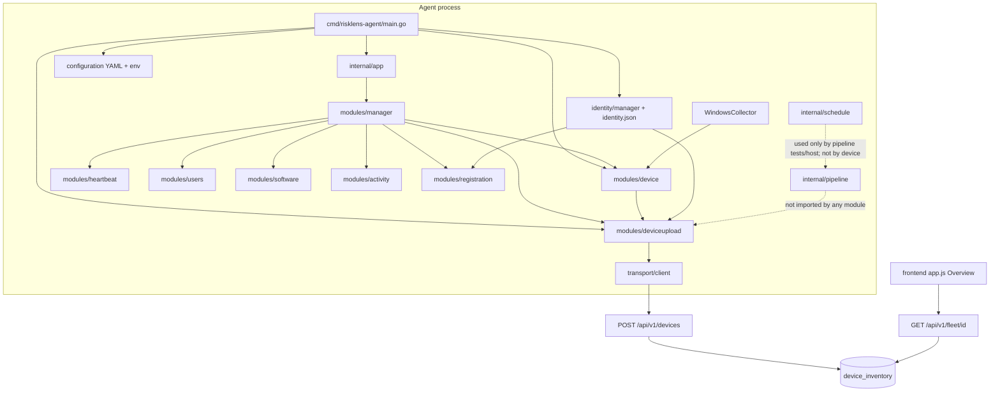

# Device Inventory — pipeline integration plan

**Status:** design only. Based on the source tree as of this document. Do not implement until approved.

**Do not:** start Phase C, modify source, create packages, wire `internal/pipeline`, or change runtime behaviour.

**Verified absences (from the current tree):**

- `agent/internal/modules/device` contains **no** `Ticker`, `Scheduler`, or `time.Sleep`.
- **No** `*.go` file under `agent/cmd` or `agent/internal/modules` imports `risklens/agent/internal/pipeline`.
- `deviceupload.Config` has only `Enabled`, `BackendURL`, `Timeout`. There is **no** interval field and **no** pipeline flag.
- `main.buildModules` constructs device as `device.New(device.Config{Enabled: true}, ...)`. YAML `device_upload.enabled` does **not** disable collection; it only gates upload.
- Overview calls `GET /api/v1/fleet/{agent_id}`, **not** `GET /api/v1/devices/{agent_id}`.

Contracts: [PIPELINE_CONTRACT.md](PIPELINE_CONTRACT.md), [PIPELINE_ARCHITECTURE.md](PIPELINE_ARCHITECTURE.md).

---

# Part 1 — Current implementation trace

Every hop below exists in source. Callers and callees are named.

**Three different types named Snapshot** (do not confuse them in Phase C):

| Type | File | Meaning |
|------|------|---------|
| `device.Snapshot` | `agent/internal/modules/device/status.go` | Module diagnostic: `State` + `Info` + `LastError` |
| `deviceupload.Snapshot` | `agent/internal/modules/deviceupload/status.go` | Upload diagnostic: `State` + HTTP fields |
| `pipeline.Snapshot` | `agent/internal/pipeline/snapshot.go` | Envelope: Kind, SchemaVersion, CollectedAt, Fingerprint, Payload, Partial. **Not used by Device today.** |

**Two different types named Collector:**

| Type | File | Signature |
|------|------|-----------|
| `device.Collector` | `agent/internal/modules/device/collector.go` | `Collect(ctx) (Info, error)` — implemented by `WindowsCollector` |
| `pipeline.Collector` | `agent/internal/pipeline/collector.go` | `Kind() string`; `Collect(ctx) (pipeline.Snapshot, error)` — **no Device implementation today** |

## 1.0 `main` → config → identity (before any collector)

| | |
|--|--|
| **Package** | `main` |
| **File** | `agent/cmd/risklens-agent/main.go` |
| **Function** | `main` → `run` |
| **Caller** | process entry |
| **Callee** | `service.IsWindowsService`; `cfgstorage.NewYAMLStore`; `cfgmanager.New`; `(*cfgmanager.Manager).Load`; `logging.New`; `idstorage.NewFileStore`; `idmanager.New`; `(*idmanager.Manager).LoadOrCreate`; `(*idmanager.Manager).Validate`; `buildModules`; `app.New`; `(*app.App).UseConfiguration`; `(*app.App).UseIdentity`; `service.Run` |

Identity is loaded **before** Device starts. `LoadOrCreate` writes or reads `%ProgramData%\RiskLens\state\identity.json` (or `cfg.Storage.IdentityFile`). Device Collect does **not** read identity. Device upload **does** (`identity.Current()`).

`model.Defaults()` sets `DeviceUpload.Enabled = false`, `Timeout = 15s`. YAML `device_upload` currently maps only `enabled` and `timeout` (`deviceUploadDoc` in `configuration/storage/yaml.go`). Env overlay: `RISKLENS_AGENT_DEVICE_UPLOAD_ENABLED`, `RISKLENS_AGENT_DEVICE_UPLOAD_TIMEOUT` (`configuration/manager/manager.go`). `validateDeviceUpload` requires `networking.backend_url` when upload is enabled; timeout must be `> 0` and `<= 5m`.

## 1.1 Process start → module list

| | |
|--|--|
| **Package** | `main` (`risklens/agent/cmd/risklens-agent`) |
| **File** | `agent/cmd/risklens-agent/main.go` |
| **Function** | `run` → `buildModules` |
| **Caller** | `main` → `run(os.Args[1:])` |
| **Callee** | `device.New`, `registration.New`, `deviceupload.New`, then heartbeat/users/software/activity |

`run` loads YAML via `cfgmanager.New` / `Load`, identity via `idMgr.LoadOrCreate`, then `buildModules(cfg, idMgr, log.Logger, logger)`.

`buildModules` appends modules **in this order** (registry preserves append order; `manager.StartAll` starts in that order):

1. `device.New(device.Config{Enabled: true}, version.Version, base)` — **Enabled is hardcoded true**, not `cfg.DeviceUpload.Enabled`.
2. `registration.New(...)` with `cfg.Registration`.
3. If `dev != nil`: `deviceupload.New(deviceupload.Config{Enabled: cfg.DeviceUpload.Enabled, BackendURL: cfg.Networking.BackendURL, Timeout: cfg.DeviceUpload.Timeout}, idMgr, dev, version.Version, base)`.
4. heartbeat, users, software, activity.

Then `app.New(..., modules...)` → `registry.Register` each module → `service.Run` → `application.Run` → `manager.StartAll`.

## 1.2 Agent start → StartAll

| | |
|--|--|
| **Package** | `app` |
| **File** | `agent/internal/app/app.go` |
| **Function** | `(*App).Run` |
| **Caller** | `service` handler execute loop |
| **Callee** | `(*manager.Manager).StartAll` |

`StartAll` (`agent/internal/modules/manager/manager.go`) loops `registry.Modules()` and calls `module.Start(ctx)`. If `Start` returns a non-nil error, it `rollback`s already-started modules. **`device.Start` and `deviceupload.Start` always return `nil`** (they `MarkFailed` / `MarkRunning` instead). So a failed device collect does **not** stop registration or heartbeat.

## 1.3 Windows → collector

| | |
|--|--|
| **Package** | `device` |
| **File** | `agent/internal/modules/device/device.go` |
| **Function** | `(*Module).Start` |
| **Caller** | `manager.StartAll` |
| **Callee** | `base.MarkStarting`; `(*Module).collector.Collect`; `classifyState`; `setSnapshot`; `MarkRunning` or `MarkFailed` |

Exact sequence in `Start`:

1. `MarkStarting()` — `base.Module` sets `StatusStarting`, `HealthUnknown`.
2. If `!m.config.Enabled`: `setSnapshot({State: StateNotCollected})`, `MarkRunning()`, return nil. (Does not happen in production `main`, which passes `Enabled: true`.)
3. `setSnapshot({State: StateCollecting, CollectedAt: m.now()})`.
4. `info, err := m.collector.Collect(ctx)`.
5. If `info.CollectedAt` is zero, set it to `m.now()` (`truncateTime`).
6. `state := classifyState(info, err)` in `collector.go`.
7. Store `device.Snapshot{State, CollectedAt, Info, LastError}` under `mu`.
8. `StateCollected` → `MarkRunning()` (status Running, health Healthy).
9. `StatePartial` → `MarkRunning()` then `SetHealth(HealthDegraded)`.
10. Else (`StateFailed`) → `MarkFailed()` (status Failed, health Unhealthy).
11. Return `nil`.

`Stop` only `MarkStopping` / `MarkStopped`. Comment in source: *“collection is synchronous and there is no background loop.”*

Constructor: `device.New` calls `NewWithCollector(cfg, &WindowsCollector{AgentVersion: agentVersion}, logger)` (`device.go`).

## 1.4 Collector → Windows APIs

| | |
|--|--|
| **Package** | `device` |
| **File** | `agent/internal/modules/device/collector_windows.go` (`//go:build windows`) |
| **Function** | `(*WindowsCollector).Collect` |
| **Caller** | `(*device.Module).Start` |
| **Callee** | listed below |

`Collect` checks `ctx.Err()` first. It fills `Info` and records per-field errors in a slice; it does **not** dial the network and does **not** shell out to PowerShell or wmic (comment on `WindowsCollector`).

| `Info` field | Function | Immediate callees |
|--------------|----------|-------------------|
| Hostname | inline in `Collect` | `os.Hostname` |
| MachineName | inline | `firstNonEmpty(os.Getenv("COMPUTERNAME"), hostname)` (`firstNonEmpty` in `collector.go`) |
| Architecture | `detectArchitecture` | `os.Getenv("PROCESSOR_ARCHITECTURE")` mapped AMD64/X64→`x86_64`, ARM64→`arm64`, X86→`x86`; else `runtime.GOARCH` |
| OperatingSystem, OSVersion, WindowsBuild | `readOSIdentity` | `registry.OpenKey(LOCAL_MACHINE, SOFTWARE\Microsoft\Windows NT\CurrentVersion)`; values `ProductName`, `CurrentBuildNumber`/`CurrentBuild`, `DisplayVersion`, `ReleaseId`, `CurrentVersion`, `CurrentMajorVersionNumber`, `CurrentMinorVersionNumber` |
| CPUModel, CPUCores | `readCPU` | `runtime.NumCPU`; registry `HARDWARE\DESCRIPTION\System\CentralProcessor\0` / `ProcessorNameString` |
| MemoryBytes | `readMemoryBytes` | `kernel32.GlobalMemoryStatusEx` → `TotalPhys` |
| DiskSizeBytes, DiskFreeBytes | `systemDrive` then `readDiskBytes` | `windows.GetSystemDirectory` or `SystemDrive` env or `C:\`; then `windows.GetDiskFreeSpaceEx` — **system volume only**, not all disks |
| Manufacturer, Model, SerialNumber | `readHardwareIdentity` | registry `HARDWARE\DESCRIPTION\System\BIOS`: `SystemManufacturer`, `SystemProductName`, `SystemSerialNumber`; each passed through `sanitizeHardwareField` (drops OEM placeholders) |
| BootTime | `readBootTime` | `kernel32.GetTickCount64`; `now.Add(-uptime)` then `truncateTime` |
| CurrentUser | `readCurrentUser` | `os/user.Current` (`Username`/`Name`); else `windows.GetUserNameEx(NameSamCompatible)`; else `USERDOMAIN`+`USERNAME` |
| AgentVersion | field copy | `WindowsCollector.AgentVersion` set by `device.New` from `version.Version` |
| CollectedAt | inline | `truncateTime(now())` — UTC, truncated to 1s |

If `info.IsEmpty()` (`model.go`: every inventory field empty, ignoring CollectedAt), Collect returns `device inventory empty`. If any field error was recorded, Collect returns `partial device inventory: …` with joined errors **and** the partial `Info`. Context cancel after probes returns `(info, ctx.Err())`.

Non-Windows: `collector_stub.go` `(*WindowsCollector).Collect` — stub, not the production path.

After Collect returns, `device.Start` calls `classifyState(info, err)` in `collector.go`:

1. `completeness(info)` counts 15 checks: MachineName, Hostname, OperatingSystem, OSVersion, WindowsBuild, CPUModel, CPUCores>0, MemoryBytes>0, DiskSizeBytes>0, DiskFreeBytes>0 **or** DiskSizeBytes>0, Architecture, any of Manufacturer/Model/SerialNumber, BootTime set, CurrentUser, AgentVersion.
2. `present == 0` → `StateFailed`.
3. `err != nil && present < total` → `StatePartial`.
4. `present < total` → `StatePartial`.
5. else → `StateCollected`.

**No fingerprint. No HTTP. No persist to disk.** Result lives in `Module.snapshot` (`device.Snapshot`: State + CollectedAt + LastError + Info) behind `mu`. Production readers of `Inventory()` / `Info()`: **only** `deviceupload.Module.Start` (plus verify scripts, not the service).

## 1.5 Registration (between collect and upload)

| | |
|--|--|
| **Package** | `registration` |
| **File** | `agent/internal/modules/registration/registration.go` |
| **Function** | `(*Module).Start` |
| **Caller** | `manager.StartAll` after device |
| **Callee** | registration HTTP client |

Registration **does not** call `device.Info()` or `device.Inventory()`. Identity comes from `idmanager` (`identity.json`). Device inventory is **not** an input to register.

## 1.6 Upload module Start

| | |
|--|--|
| **Package** | `deviceupload` |
| **File** | `agent/internal/modules/deviceupload/deviceupload.go` |
| **Function** | `(*Module).Start` |
| **Caller** | `manager.StartAll` after registration |
| **Callee** | `identity.Current`, `inventory.Inventory`, `RequestFromInventory`, `(*Client).Upload` |

Exact branches:

1. `MarkStarting`.
2. If `!m.config.Enabled`: status `StateSkipped`, `MarkRunning`, return nil. **No POST.** (`Defaults()` sets `DeviceUpload.Enabled = false`; example YAML often false.)
3. `id, ok := m.identity.Current()` — `idmanager.Manager.Current`. If `!ok`: `StateFailed`, `MarkFailed`, return nil. **No POST.**
4. `deviceSnap := m.inventory.Inventory()` — **read-only**. Comment in source: *“The upload module never recollects hardware data.”*
5. If state is not `StateCollected` or `StatePartial`: `StateSkipped`, `MarkRunning`, return nil.
6. If `info.IsEmpty()` or both machine_name and hostname empty: `StateSkipped`, `MarkRunning`, return nil.
7. `StateUploading`.
8. `req := RequestFromInventory(id.AgentID, id.InstallID, info)` (`request.go`). Maps `DiskSizeBytes` → `disk_total_bytes`. Does **not** call Collect again.
9. `result, err := m.client.Upload(ctx, req)`.
10. Success: `StateUploaded`, `MarkRunning`.
11. Failure: `StateFailed`, `MarkFailed`. **No retry. No loop. Stop is a no-op besides MarkStopped.**

`InventorySource` is satisfied by `*device.Module` (`Inventory`, `Info`).

## 1.7 Client → Transport

| | |
|--|--|
| **Package** | `deviceupload` |
| **File** | `agent/internal/modules/deviceupload/client.go` |
| **Function** | `(*Client).Upload` |
| **Caller** | `(*deviceupload.Module).Start` |
| **Callee** | `transport.BuildRequest`, `transport.Send`, `transport.DecodeResponse` |

1. `BuildRequest(MethodPOST, "/api/v1/devices", req)` — path constant `EndpointPath`.
2. `Send(ctx, txReq)` — `agent/internal/transport/client/client.go` (`net/http`; only package allowed to import it).
3. Status 200 or 201: decode `SuccessResponse`; require `accepted && inventory_status == "stored"`.
4. 404 → `ErrUnknownAgent`; 400/422 → `ErrValidation`; 5xx → `ErrServer`; else `ErrUnexpectedStatus`.
5. Transport errors → `ErrTransport` or `ErrMalformedResponse`.

`NewClient` builds `txclient.New` with `BaseURL`, `Timeout` from config, User-Agent `RiskLensAgent/{version}`.

## 1.8 HTTP → backend

| | |
|--|--|
| **Package** | `app.api.v1.devices` |
| **File** | `platform/app/api/v1/devices.py` |
| **Function** | `upload_device_inventory` |
| **Caller** | FastAPI: `platform/app/api/router.py` `include_router(devices.router, prefix="/api/v1/devices")` so this is `POST /api/v1/devices` |
| **Callee** | `DeviceInventoryRequest.to_command` (`platform/app/schemas/devices.py`); `DeviceInventoryService.upsert` |

`to_command` copies every request field into `UpsertDeviceInventoryCommand` with **no transformation**.

Sets HTTP 201 if `created` else 200. Body (`DeviceInventoryResponse`): `accepted=True`, `agent_id`, `created`, `inventory_status="stored"`, `server_version` from settings, `server_time` now UTC, `received_at` from stored row.

Agent success gate (`Client.Upload`): status 200 or 201 **and** `accepted` **and** `inventory_status == "stored"` (`deviceupload/response.go` `SuccessResponse`).

## 1.9 Backend service → database

| | |
|--|--|
| **Package** | `app.services.device_service` |
| **File** | `platform/app/services/device_service.py` |
| **Function** | `DeviceInventoryService.upsert` |
| **Caller** | `upload_device_inventory` |
| **Callee** | `AgentRepository.exists`; `DeviceInventoryRepository.upsert`; optional `_projection.on_inventory` |

If `AgentRepository.exists(command.agent_id)` is false → `UnknownAgentError` (HTTP 404). Otherwise builds `DeviceInventory` with string fields stripped and `received_at = clock()` (UTC now). Then `DeviceInventoryRepository.upsert`. If a projection is wired, `projection.on_inventory(agent_id, received_at)`.

| | |
|--|--|
| **Package** | `app.infrastructure.postgres.device_inventory_repository` |
| **File** | `platform/app/infrastructure/postgres/device_inventory_repository.py` |
| **Function** | `PostgresDeviceInventoryRepository.upsert` |
| **Caller** | `DeviceInventoryService.upsert` |
| **Callee** | `session.get(DeviceInventoryRow, agent_id)` then `pg_insert(DeviceInventoryRow).on_conflict_do_update(index_elements=[agent_id])` |

Table: `device_inventory` (`platform/app/infrastructure/postgres/models.py` `DeviceInventoryRow`). PK `agent_id`. FK to `agents.agent_id`. Repeated POSTs overwrite every column except the PK. **No history table.**

Projection:

| | |
|--|--|
| **Package** | `app.services.fleet_service` |
| **File** | `platform/app/services/fleet_service.py` |
| **Function** | `FleetService.on_inventory` |
| **Caller** | `DeviceInventoryService.upsert` (projection hook) |
| **Callee** | `AgentStatusRepository.record_inventory` |

`PostgresAgentStatusRepository.record_inventory` (`platform/app/infrastructure/postgres/fleet_repository.py`) sets `agent_status.last_inventory_at = received_at` and advances `last_communication_at` if later. **Does not change `last_seen`.** Overview Online/Offline still comes from heartbeat `last_seen`.

## 1.10 Database → Overview (read path)

Overview does **not** call `GET /api/v1/devices` or `GET /api/v1/devices/{agent_id}`. Those routes exist on the backend (`devices.py` list/get) but the SPA Overview tab does not use them.

| | |
|--|--|
| **Package** | SPA (vanilla JS) |
| **File** | `frontend/assets/app.js` |
| **Function** | `loadFleetDetail` |
| **Caller** | `openFleetAgent` / hash routing (`renderFleetDetail` after fetch) |
| **Callee** | `fetchJson(platformUrl("/api/v1/fleet/" + encodeURIComponent(agentId)))` then `renderFleetDetail` |

When `state.fleet.tab === "overview"`, `renderFleetDetail` sets `body.innerHTML = renderEndpointOverview(item)`.

`renderEndpointOverview` cards: Hostname (`hostname` or `machine_name`), Machine, Current User, Agent ID, Operating System, Version (`agent_version`, **not** OS version), Policy (`policy_name`), Group (always empty string), Tags, Status (`presenceLabel(online_status)`), Last Seen. Hardware list: os_version, windows_build, architecture, manufacturer, model, serial_number, cpu_model, cpu_cores, memory_bytes, disk_total_bytes, disk_free_bytes, last_inventory_at. **One GET. No setInterval for Overview.**

| | |
|--|--|
| **Package** | `app.api.v1.fleet` |
| **File** | `platform/app/api/v1/fleet.py` |
| **Function** | `get_fleet_agent` |
| **Caller** | browser |
| **Callee** | `FleetService.get` then `_to_item` |

`FleetService.get`:

1. `AgentRepository.exists`; else `FleetAgentNotFoundError`.
2. `{row.agent_id: row for row in self._all_records()}` then pick `agent_id`. **Loads every agent’s joined records** to serve one id.

`_all_records` joins: `agents.list()`, `DeviceInventoryRepository.list()` keyed by agent_id, latest heartbeats, `agent_status.list_map()`, policy assignments, tags. `_to_record` copies inventory hostname/machine/OS/hardware/current_user onto the fleet item; `last_seen` from `agent_status.last_seen` else heartbeat time; `last_inventory_at` from `agent_status.last_inventory_at` else `inventory.received_at`; `online_status` from `compute_fleet_status(last_seen, has_inventory=…)`. Presence is **not** “last device POST succeeded”.

---

# Part 2 — Dependency map



### Direct Device Inventory participants

| Layer | Files |
|-------|--------|
| Collect | `device/device.go`, `collector.go`, `collector_windows.go`, `collector_stub.go`, `model.go`, `status.go` |
| Upload | `deviceupload/deviceupload.go`, `client.go`, `request.go`, `response.go`, `status.go` |
| Wire | `cmd/risklens-agent/main.go` |
| Host | `app/app.go`, `modules/manager/manager.go`, `modules/registry/registry.go`, `modules/base/module.go`, `modules/interfaces/module.go` |
| Identity | `identity/manager`, `identity/storage` (`identity.json`) |
| Config | `configuration/model` `DeviceUpload`, `validation.validateDeviceUpload`, `storage/yaml.go` `device_upload`, `manager` env, `configs/agent*.yaml` |
| Transport | `transport/interfaces`, `transport/client`, `transport/request`, `transport/response`, `transport/errors`, `transport/middleware` |
| Backend POST | `platform/app/api/v1/devices.py`, `schemas/devices.py`, `services/device_service.py` |
| DB | `infrastructure/postgres/device_inventory_repository.py`, `models.py` `DeviceInventoryRow` |
| Status side effect | `fleet_service.on_inventory`, `postgres/fleet_repository` `last_inventory_at` |
| Overview | `api/v1/fleet.py` `get_fleet_agent`, `fleet_service.get`, `frontend/assets/app.js` `loadFleetDetail` / `renderEndpointOverview` |

### Indirect

- `version.Version` into `WindowsCollector.AgentVersion` and User-Agent.
- Logging (`internal/logging`) used by modules; not inventory-specific.
- `service/windows.go` runs App; does not call Collect.
- Verify scripts: `agent/scripts/verify_device/main.go`, `verify_device_restart/main.go` (not the product path).

### Shared components (must not be rewritten for Phase C)

- Transport stack (all modules).
- Module manager / registry / base.
- Identity manager.
- Configuration loader (extend DeviceUpload keys only).
- FastAPI container / settings.

### Configuration (current Device upload keys only)

From `configuration/model/config.go` and `storage/yaml.go`:

- `device_upload.enabled` (bool; `Defaults()` **false**)
- `device_upload.timeout` (duration; default 15s)
- Env: `RISKLENS_AGENT_DEVICE_UPLOAD_ENABLED`, `RISKLENS_AGENT_DEVICE_UPLOAD_TIMEOUT`
- `networking.backend_url` required when upload enabled (`validateDeviceUpload`)

**No** `device_upload.interval`. **No** `device_upload.pipeline`.

Device **collection** enable is `device.Config.Enabled`, passed as **true** in `main`, not from YAML.

### State files

| Path | Role in Device Inventory |
|------|--------------------------|
| `%ProgramData%\RiskLens\state\identity.json` | `agent_id` / `install_id` for POST body |
| Agent YAML | upload enabled/timeout/backend URL |
| **None** | Device `Info` is **memory only**. Process exit loses it. |

Activity queue JSON is **not** used by device.

### Transport

Shared `txclient`; Device uses POST `/api/v1/devices` only.

### Scheduler (current Device)

**Device has no scheduler.** Heartbeat (`internal/modules/heartbeat/scheduler.go`), users, software, and activity each have **private** tickers. `internal/schedule` exists (Phase A) and is imported by `internal/pipeline` (Phase B) only — **not** by device or deviceupload.

---

# Part 3 — Current lifecycle

```
Agent process start
  load config, identity
  StartAll:
    device.Start     → Collect once → memory
    registration.Start
    deviceupload.Start → POST once or skip/fail
    heartbeat.Start  → loop (unrelated)
    users/software/activity loops (unrelated)
  wait until shutdown
  StopAll reverse order
    deviceupload.Stop  → MarkStopped only (no loop to cancel)
    device.Stop        → MarkStopped only
```

### `device.Snapshot.State` (`device/status.go`)

```
NotCollected  (construction; or Start with Enabled false)
    → Collecting   (Start, before Collect returns)
        → Collected  (classifyState complete)
        → Partial    (some fields missing; module still Running, HealthDegraded)
        → Failed     (empty/useless; module Failed, HealthUnhealthy)
```

No transition back to Collecting. **Terminal until process restart.**

### `deviceupload.Snapshot.State` (`deviceupload/status.go`)

```
NotUploaded  (construction)
    → Skipped    (disabled, inventory not Collected/Partial, empty name)
    → Uploading
        → Uploaded   (HTTP 200/201 accepted stored)
        → Failed     (identity missing, transport/HTTP error)
```

Failed is **terminal**. No retry. Module `MarkFailed`. Heartbeat still starts afterward because Start returned nil.

### Module `interfaces.Status`

Start: Starting → Running or Failed. Stop: Stopping → Stopped. Device Failed still leaves later modules starting.

---

# Part 4 — Target lifecycle

Uses existing `pipeline.Pipeline.tick` (`agent/internal/pipeline/pipeline.go`) and `schedule.Scheduler` (`agent/internal/schedule/scheduler.go`). Device must **adapt**, not duplicate.

```
Agent start
  StartAll:
    device.Start          → if pipeline mode: no Collect (or Collect only if flag off)
    registration.Start    → unchanged
    deviceupload.Start    → if pipeline mode: pipeline.Start
                              (scheduler immediate tick)
                              Collector.Collect
                              pipeline.Snapshot + Fingerprint
                              compare lastSuccessfulFingerprint
                              skip or Uploader.Upload → same POST /api/v1/devices
                              remember fingerprint on success / pending on fail
                              wait interval ± jitter
                              repeat until Stop
    heartbeat/...         → unchanged, own loops
  shutdown
    deviceupload.Stop → pipeline.Stop (cancel ctx, wait loop)
    device.Stop
```

### Pipeline state (`pipeline.go`, already implemented)

| Memory field | Meaning |
|--------------|---------|
| `lastSuccess` | Fingerprint of last **successful** upload; empty at process start |
| `pending` | Last upload failed; next tick must POST even if fingerprint equal |
| `health` | Disabled / Warning / Healthy / Error |

Tick (`Pipeline.tick` in `pipeline.go`, invoked by `schedule.Scheduler`):

1. `schedule.Scheduler.Start` → goroutine `loop` → **immediate** `run` (no wait, no jitter) → later `nextWait()` = Interval ± Jitter, skip if `inflight.TryLock` fails.
2. `tick`: `recover` panics → log `Collector Recovered`, `HealthError`.
3. Optional `context.WithTimeout` from `pipeline.Config.Timeout`.
4. `collector.Collect(ctx)` → `pipeline.Snapshot`.
5. If ctx cancelled and not `Uploadable()` → return (no upload).
6. If not `Uploadable()` (`Fingerprint` empty or `Payload` nil) → `HealthError`, no upload.
7. If `shouldSkip(fingerprint)` (`lastSuccess` equal and not `pending`) → no HTTP; health Healthy or Warning if Partial.
8. Else `uploader.Upload`. Failure → `markPending`, `HealthWarning`, log `Retry Scheduled`. Success → `remember(fingerprint)`, clear pending.

Module host **must not** `MarkFailed` on upload error in pipeline mode (today’s one-shot `MarkFailed` is the old behaviour). Isolation: this loop is Device-only; heartbeat keeps its own ticker.

### `device.Snapshot.State` after integration

Must become **non-terminal**: each Collect can move Collecting → Collected | Partial | Failed again. Failed collect must **not** stop the Pipeline loop (`PIPELINE_CONTRACT` §8 / §12).

### First tick

`schedule.Scheduler.loop` calls `run` **before** waiting. Empty `lastSuccess` ⇒ first Uploadable snapshot **always POSTs**. Restart ⇒ memory empty ⇒ POST again.

---

# Part 5 — Migration plan

Incremental. Each step reversible. **Default runtime stays Part 3 until Step 6 flag is on.**

Proposed **new** keys (do not exist today): `device_upload.interval`, `device_upload.pipeline` (bool, default **false**). Env names to match existing `RISKLENS_AGENT_DEVICE_UPLOAD_*` pattern.

### Step 1 — Refreshable collect, one-shot Start unchanged

| | |
|--|--|
| **Purpose** | Recollect into `Module.snapshot` without a ticker |
| **Files** | `device/device.go`, `device/device_test.go` |
| **Risk** | Low. Production still only calls Collect from Start |
| **Rollback** | Revert the two files |
| **Verification** | Existing Start tests pass. New test: fake collector returns Info A then B; `Refresh`/`Collect` updates `Info()` |
| **Expected behaviour** | Product path identical (Start still the only production Collect) |

### Step 2 — Fingerprint helper, unused by Start/upload

| | |
|--|--|
| **Purpose** | Pure hash of comparable `device.Info` fields |
| **Files** | **New** `device/fingerprint.go` (file inside existing package, not a new package), `device/fingerprint_test.go` |
| **Risk** | Wrong field set (include CollectedAt ⇒ always “changed”) |
| **Rollback** | Delete helper; nothing calls it yet |
| **Verification** | Same Info, different CollectedAt → equal fingerprint. DiskFreeBytes change → unequal. No `time.Now` in hash |
| **Expected behaviour** | Runtime identical |

Exclude from fingerprint (contract): `CollectedAt`, applied by `device.Info.Comparable()` in the Device module, not by the pipeline adapter. Include: hostname, machine name, OS, version, build, arch, CPU, cores, memory, disk total/free, manufacturer, model, serial, boot time, current user, agent version, partial flag. Kind `"device"`, schema `pipeline.SchemaVersionV1`.

### Step 3 — `device.Module` implements `pipeline.Collector`

| | |
|--|--|
| **Purpose** | `Kind() string` = `"device"`; `Collect(ctx)` Refresh + build `pipeline.Snapshot` with Payload=`Info` |
| **Files** | `device/device.go`, device tests |
| **Risk** | Confusing `device.Snapshot` vs `pipeline.Snapshot`. Adapter must not live in `internal/pipeline` |
| **Rollback** | Remove interface methods; keep Refresh |
| **Verification** | Test Collect via `pipeline.Collector` variable. `internal/pipeline` still has **zero** device imports |
| **Expected behaviour** | Runtime identical (main does not Start Pipeline) |

### Step 4 — `pipeline.Uploader` adapter in deviceupload

| | |
|--|--|
| **Purpose** | `Upload(ctx, pipeline.Snapshot)` type-assert Payload to `device.Info`, `RequestFromInventory`, existing `Client.Upload` |
| **Files** | **New** `deviceupload/uploader.go` (same package), tests |
| **Risk** | Wrong type assert; JSON shape drift |
| **Rollback** | Delete adapter; `Module.Start` still uses Client directly |
| **Verification** | Fake Transport: one Snapshot → one POST `/api/v1/devices`; body matches current `Request` tags |
| **Expected behaviour** | Runtime identical |

Do **not** change `Client.Upload` signature or `Request` JSON.

### Step 5 — Config interval + pipeline flag, unused at runtime

| | |
|--|--|
| **Purpose** | Parse `interval` (1m–1h, default 5m) and `pipeline` bool (default false) |
| **Files** | `configuration/model/config.go`, `validation/validate.go`, `storage/yaml.go`, `manager/manager.go`, `agent.example.yaml`, `agent.lan.example.yaml`, `main.go` (pass into Config structs only) |
| **Risk** | Invalid YAML breaks agent start; default must keep one-shot |
| **Rollback** | Revert config files; ignore unknown YAML if already shipped — prefer not shipping Step 5 without default false |
| **Verification** | Config tests: missing keys → pipeline false, interval 5m. `pipeline: false` → `deviceupload.Start` still one-shot (assert in Step 5 test that Pipeline is not constructed) |
| **Expected behaviour** | Runtime identical |

### Step 6 — Host Pipeline when `pipeline: true`

| | |
|--|--|
| **Purpose** | Cutover behind flag |
| **Files** | `deviceupload/deviceupload.go` Start/Stop; `device/device.go` Start skip Collect when pipeline mode; `main.go` pass flag into **both** configs |
| **Risk** | Flag true **and** one-shot POST ⇒ duplicate upload. Flag true **and** device.Start still Collects ⇒ double Collect at t=0 |
| **Rollback** | `device_upload.pipeline: false` + restart. Keep one-shot code in Start |
| **Verification** | Flag false: Transport.Send count == 1 at start, still 1 after waiting interval. Flag true: Send >= 1 immediately; same fingerprint ⇒ no second Send; changed Info ⇒ second Send; Stop ends ticks; heartbeat tests still pass |
| **Expected behaviour** | Flag false = Part 3. Flag true = Part 4 for Device only |

When flag true, `deviceupload.Start` **must not** call `Client.Upload` except through the adapter. `MarkFailed` on upload error **must not** be used (Pipeline retries; isolation). Identity missing: skip starting Pipeline or tick fails collect/upload without killing other modules.

### Step 7 — Remove one-shot live path (only after Step 6 accepted)

| | |
|--|--|
| **Purpose** | Pipeline is the Device path |
| **Files** | `deviceupload.go` delete one-shot POST block; optionally default `pipeline: true` in example YAML only after approval |
| **Risk** | Labs with old YAML (`pipeline` absent) if default flips to true |
| **Rollback** | Git revert Step 7; or keep flag default false forever until ops update YAML |
| **Verification** | No production call to `Client.Upload` except Uploader; `go test` device + deviceupload + pipeline + configuration |
| **Expected behaviour** | Recurring Device inventory; other collectors unchanged |

Do not migrate users/software/heartbeat in these steps.

---

# Part 6 — Files that change

| File | Current responsibility | Future responsibility | Reason |
|------|------------------------|----------------------|--------|
| `device/device.go` | One-shot `Start` Collect | Refresh + `pipeline.Collector`; Start Collect gated | Recollect |
| `device/fingerprint.go` | Does not exist | Hash `Info` | Compare |
| `device/device_test.go` / `fingerprint_test.go` | One-shot | Refresh, hash, adapter | Proof |
| `deviceupload/deviceupload.go` | One-shot POST | Pipeline host when flag on | Wire |
| `deviceupload/uploader.go` | Does not exist | `pipeline.Uploader` | Adapter |
| `deviceupload/deviceupload_test.go` | One-shot | Both flag modes | Proof |
| `deviceupload/client.go` | POST | **Unchanged API** | Called by adapter |
| `deviceupload/request.go` | DTO | **Unchanged JSON** | Backend contract |
| `cmd/risklens-agent/main.go` | Pass enabled/timeout | Pass interval, pipeline, device mode | Construction |
| `configuration/model/config.go` | Enabled, Timeout | + Interval, Pipeline | Config |
| `configuration/validation/validate.go` | Timeout | + interval bounds | Safety |
| `configuration/storage/yaml.go` | enabled, timeout | + interval, pipeline | YAML |
| `configuration/manager/manager.go` | two env vars | + interval, pipeline env | Env |
| `configs/agent.example.yaml` | no interval | document keys | Operators |
| `configs/agent.lan.example.yaml` | same | same | Lab |
| Docs listed in Part 12 | describe one-shot | describe pipeline Device | After cutover |

Optional comment-only: `device/status.go`, `deviceupload/status.go` to distinguish from `pipeline.Snapshot`.

`collector_windows.go`: **no functional change** in Phase C (Current User / OS name are later OV items).

---

# Part 7 — Files that MUST NOT change

| Area | Evidence / paths | Why |
|------|------------------|-----|
| Backend POST contract | `devices.py` `upload_device_inventory`, `DeviceInventoryRequest` | Same JSON; upsert already overwrites |
| Fleet GET | `fleet.py` `get_fleet_agent`, `fleet_service.py` | Overview read path |
| Database schema | `models.py` `DeviceInventoryRow`, migrations | No new table |
| Frontend | `frontend/assets/app.js` Overview | Still one Fleet GET; poll is OV-1.2 |
| Heartbeat | `internal/modules/heartbeat/**` | Own scheduler; presence |
| Users | `internal/modules/users/**` | Own 5m loop in `users/upload.go` |
| Software | `internal/modules/software/**` | Own 15m loop |
| Activity / sessions | `internal/modules/activity/**` | Usage + disk queue |
| Registration | `internal/modules/registration/**` | Does not read device Info |
| Transport protocol | `internal/transport/**` | Shared HTTP; Device only adds calls to existing POST |
| Policy APIs | `fleet.py` policy routes | Assigned policy, not Device collect |
| Pipeline internals | `internal/pipeline/*.go` | Frozen Phase B; Device adapts |
| Schedule internals | `internal/schedule/*.go` | Used as-is |
| Identity format | `identity/**` | Same UUIDs in POST |
| Session APIs | `platform/app/api/v1/sessions.py` | Not Device |

`GET /api/v1/devices` remaining unused by Overview is acceptable.

---

# Part 8 — Risk analysis

| Risk | Source in current code | Mitigation |
|------|------------------------|------------|
| Duplicate POST at t=0 | Step 6 still runs `Start` one-shot **and** Pipeline tick 0 | Mutually exclusive branches; test Send count |
| Missing POST | `Enabled false` (already); or pipeline on but Start skipped | Test flag true ⇒ ≥1 POST; identity required as today |
| Fingerprint always changes | Hashing `CollectedAt` (set every Collect in `WindowsCollector` and `device.Start`) | Exclude CollectedAt in Step 2 tests |
| Fingerprint never changes | Omitting `DiskFreeBytes` / `CurrentUser` | Include those fields; test |
| Infinite POST loop | Non-deterministic hash or pending never cleared | Pipeline already clears pending on success; fingerprint tests |
| Missing upload after fail | Today `MarkFailed` never retries | Pipeline pending + next tick; **intentional** change only when flag true |
| Scheduler overlap | Adding a ticker on **both** device and deviceupload | Only deviceupload hosts Pipeline |
| Race `Info()` vs Collect | `setSnapshot` already uses `mu` | Refresh uses same lock; Payload copy for upload |
| Deadlock | Uploader calling back into device.Collect | Adapter uses Snapshot.Payload only |
| Memory leak | Pipeline goroutine if Stop not called | `deviceupload.Stop` → `Pipeline.Stop`; manager StopAll |
| Panic kills agent | Collect panic | `Pipeline.tick` already `recover`; Device Collect should not panic |
| Partial treated as full | `classifyState` Partial still uploads today | Keep Partial on `pipeline.Snapshot`; health Warning |
| Corrupt snapshot | Empty Info POST | Today skip if `IsEmpty` or no hostname/machine; adapter must keep that skip (`Uploadable` + name check) |
| Config mistake | Default pipeline true | Default **false** until Step 6 accepted |
| Unexpected shutdown | In-flight POST | Scheduler Stop waits; timeout from existing `device_upload.timeout` as Pipeline `Config.Timeout` |
| Reboot | Memory fingerprint gone | First tick POSTs (same as cold start today) |
| Empty window | Skip device.Start Collect, something reads Info before tick 0 | Current readers: deviceupload only (+ verify scripts). Tick 0 is immediate in same StartAll as deviceupload.Start |
| Fleet Offline | Confusing Failed upload with heartbeat | Isolation: do not stop heartbeat; Overview status is `last_seen` |
| Double Collect | device.Start Collect + Pipeline Collect | When flag true, device.Start must not Collect |
| `main` Enabled true vs YAML | Collection always on even if upload disabled | Do not silently change that in C unless documented; upload still gated by `device_upload.enabled` |

---

# Part 9 — Rollback plan

**While Step 6 one-shot code remains:** set `device_upload.pipeline: false` (or omit key). Restart `RiskLensAgent`. Behaviour returns to Part 3. No DB/UI rollback.

**After Step 7 deletes one-shot:** `git revert` the Device/deviceupload/`main`/config commits. Leave `internal/pipeline` and `internal/schedule` in tree (unused). No migration to un-apply.

**Do not** roll back by setting `device_upload.enabled: false` unless that was already production — that stops all device POSTs.

Each of Steps 1–5 is reverted by reverting those files only; runtime never left Part 3.

---

# Part 10 — Verification plan

### Every step

- `go test` packages touched that step
- `go test ./internal/modules/heartbeat ./internal/modules/users ./internal/modules/software ./internal/modules/registration` if `main`/config touched
- Confirm `git grep pipeline` in `cmd` and `modules` shows **no** import until Step 3+ (device/deviceupload only)

### Step 1

- Start still Collects once; Refresh is extra API

### Step 2

- Fingerprint tests only; `deviceupload` tests still one POST per Start

### Step 3–4

- Adapter unit tests; production Start path still `Client.Upload` from `Module.Start`

### Step 5

- YAML without new keys still loads; `pipeline` defaults false; one-shot still runs

### Step 6 (flag false)

- Identical to today: one POST if enabled and inventory ok; no POST after wait; Overview/registration/heartbeat manual checks

### Step 6 (flag true, lab)

- Immediate POST; no duplicate at t=0; skip when idle; POST after disk-free change without restart; Stop clean; restart POSTs again; API down then up ⇒ retry without agent restart; heartbeat Online while Device Warning; Overview **reload** shows new disk free (open page may stay stale — OV-1.2)

### Step 7

- One-shot function gone; flag-off behaviour documented or preserved

---

# Part 11 — Regression checklist

After **every** step, these must still work as they do **today** (except Device upload cadence when flag true):

| Item | Pass criterion |
|------|----------------|
| Registration | `POST /api/v1/agents/register` still succeeds independently of inventory |
| Fleet | `GET /api/v1/fleet` lists agents |
| Overview | `loadFleetDetail` + `renderEndpointOverview` still render Fleet JSON |
| Heartbeat | 30s POST; Online/Warning/Offline from `last_seen` |
| Sessions | Activity module and Sessions tab unchanged |
| Online / Offline | Not tied to Device POST |
| Accounts | `users` module interval loop unchanged |
| Installed Applications | `software` module interval loop unchanged |
| Policies | `GET /api/v1/fleet/{id}/policy` unchanged |
| Backend APIs | Device POST schema; Fleet GET schema; other v1 routes |
| Database | One `device_inventory` row per agent; upsert |
| Frontend | No `app.js` edits in Phase C |

---

# Part 12 — Definition of Done

Phase C is complete only when:

- ☐ Device Inventory uses Pipeline (`deviceupload` hosts `pipeline.Pipeline` on the live path)
- ☐ Old implementation removed (one-shot `deviceupload.Start` POST is not live; `device.Start` is not the only Collect; Device has no private ticker)
- ☐ Runtime behaviour verified (Part 10 Step 6/7 manual)
- ☐ Backend unchanged
- ☐ Frontend unchanged
- ☐ Database unchanged
- ☐ Tests pass (`device`, `deviceupload`, `pipeline`, `schedule`, configuration)
- ☐ Manual verification completed
- ☐ Documentation updated (`09_INVENTORY.md`, `10_CONFIGURATION.md`, `03_AGENT_ARCHITECTURE.md`, this file / OV-1.1 Phase C)

Contract extras:

- ☐ Kind `device` isolated (own scheduler, fingerprint, health)
- ☐ Device upload failure does not stop heartbeat or the process
- ☐ Unchanged fingerprint does not POST
- ☐ First tick POSTs without waiting a full interval

---

## After approval

Implement **Step 1 only**. Stop for review. Do not enable `pipeline: true` until Step 6 is the approved task.
