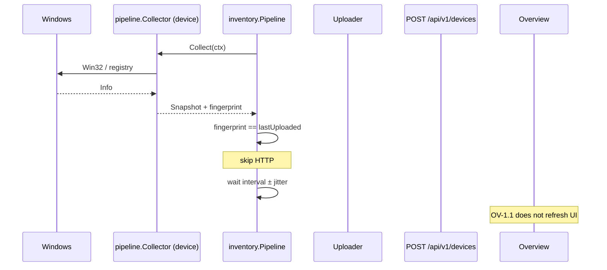
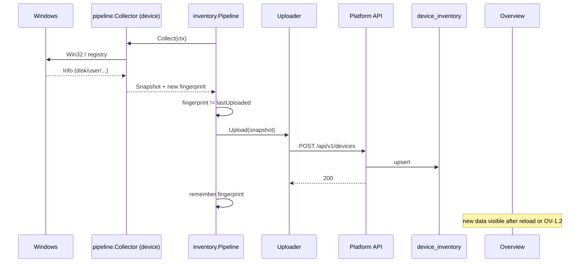
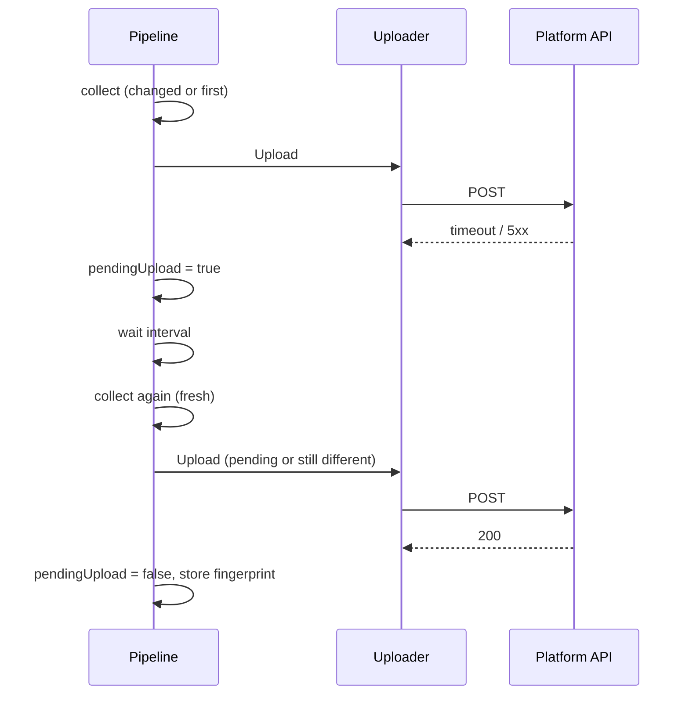
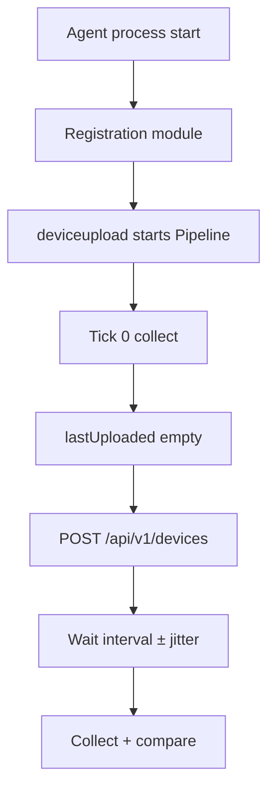
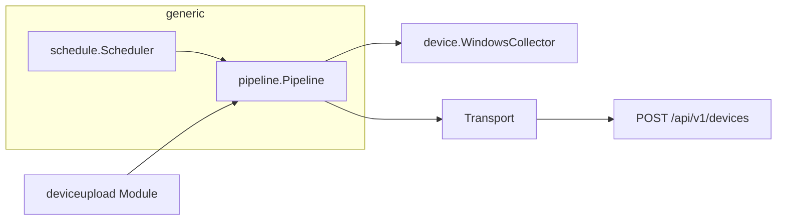

# OV-1.1 Engineering design — Recurring Inventory Collection

Status: **Phase A implemented.** Shared scheduler exists. Device collect/upload, backend, and frontend are unchanged. Do not start Phase B until approved.

This is the foundation of the collection pipeline. It must be generic. Device / Overview is the first producer, not the only one.

Roadmap item: [OVERVIEW_ROADMAP.md](OVERVIEW_ROADMAP.md) **OV-1.1**.  
Pipeline model: [PIPELINE_ARCHITECTURE.md](PIPELINE_ARCHITECTURE.md).

---

## Package naming (approved)

Do **not** use `internal/inventory`.

| Package | Role | Why this name |
|---------|------|----------------|
| `agent/internal/schedule` | Shared ticker | Matches existing heartbeat `Scheduler`. Usable by pipeline hosts **and** by heartbeat / activity / browser jobs that are not compare-and-upload. |
| `agent/internal/pipeline` | Collector → Snapshot → Fingerprint → Pipeline → Uploader | Orchestrator. Chosen over `internal/collector` because modules already own `Collector` types that talk to Windows. A top-level `collector` package would collide and look like the gatherer, not the loop. |

The Pipeline must never import `device.Info` or any concrete inventory type.

---

## Final scheduler architecture (Phase A)

Implemented in `agent/internal/schedule`. **Not wired** into device, deviceupload, heartbeat, users, software, or activity. Zero observable product change.

```
Start(ctx)
  → run Func immediately (no wait, no jitter)
  → loop:
       wait Interval + offset, offset ∈ [-Jitter, +Jitter] (0 jitter = exact Interval)
       if previous Func still running → skip this tick
       else run Func(ctx)
  → Stop() or parent ctx cancel
       cancel in-flight ctx
       wait for loop goroutine
```

| Requirement | How |
|-------------|-----|
| Immediate first execution | `loop` calls `run` before the first timer |
| Configurable interval | `Config.Interval` (must be `> 0`) |
| Configurable jitter | `Config.Jitter` (must be `>= 0`; `0` disables). First tick never jitters. Wait clamped to ≥ 1ms |
| No overlapping executions | `inflight.TryLock`; skip if held |
| Graceful stop | `Stop` cancels and waits on `done` |
| Context cancellation | Child ctx from parent; in-flight `Func` sees `ctx.Done()` |
| Thread safe | Start/Stop mutex; second Start is a no-op; Stop is idempotent |
| Reusable | `Func` only; no collector or HTTP types |

Heartbeat’s private scheduler remains the runtime path until a later migrate. This package is the **standard** going forward.

Tests: `agent/internal/schedule/scheduler_test.go`.

---

## 1. Existing architecture

### End-to-end path today (device / Overview)

```
Windows Win32/registry
  → device.WindowsCollector.Collect (once in device.Module.Start)
  → in-memory device.Info
  → deviceupload.Module.Start (once)
  → POST /api/v1/devices
  → DeviceInventoryService.upsert
  → device_inventory row (PK agent_id)
  → GET /api/v1/fleet/{id}
  → renderEndpointOverview
```

There is **no scheduler** on this path after start.

### Module manager

`internal/modules/manager` starts modules **in registration order**, stops them in reverse. A module `Start` error rolls back already-started modules. Device, users, software, and deviceupload **never return Start errors**; they `MarkFailed` / `MarkRunning` and return nil so the service stays up.

Order in `cmd/risklens-agent/main.go`:

1. `device` — one-shot collect
2. `registration` — `POST /api/v1/agents/register`
3. `deviceupload` — one-shot `POST /api/v1/devices`
4. `heartbeat` — interval loop
5. `users` — interval collect+upload
6. `software` — interval collect+upload
7. `activity` — interval + disk queue (usage, not inventory)

### Schedulers that already exist (duplicated)

| Package | Type | Immediate first tick | Overlap guard | Change detection | Retry queue |
|---------|------|----------------------|---------------|------------------|-------------|
| `heartbeat` | exported `Scheduler` | yes | `TryLock` skip | n/a (always send) | no |
| `users` | private copy | yes | same | **none** (always POST) | no |
| `software` | private copy | yes | same | **none** (always POST) | no |
| `activity` | private copy | yes | same | n/a (events) | disk JSON queue |
| `device` / `deviceupload` | **none** | n/a | n/a | n/a | no |

Heartbeat’s scheduler is the only one with dedicated tests (`TestSchedulerNoOverlap`, `TestSchedulerGracefulStop`).

### Transport

All HTTP goes through `internal/transport/interfaces.Transport` (`BuildRequest` / `Send` / `DecodeResponse`). Modules must not import `net/http`. Device upload client lives in `deviceupload`; users/software each have their own Client with the same shape.

### Backend / database

`POST /api/v1/devices` → `DeviceInventoryService.upsert` replaces the **latest** `device_inventory` row for `agent_id`. Repeats are already safe (201 first, 200 later). No inventory history table. `agent_status.last_inventory_at` updates on receive.

Users and software already upsert on an interval; they are **not** one-shot. They just have no shared pipeline and no fingerprint skip.

### Frontend

Overview reads Fleet GET once (`loadFleetDetail`). OV-1.1 does **not** change the SPA. Live UI is OV-1.2. After OV-1.1, a **reload / re-open** of the endpoint is required to see new hardware.

---

## 2. Problems with the current implementation

1. **Device inventory is one-shot.** Disk free, current user, hostname, memory, boot time freeze until agent restart.
2. **Collect and upload are split modules with no loop.** `device.Stop` is a no-op; `deviceupload.Stop` is a no-op. There is nothing to tick.
3. **Schedulers are copy-pasted** in heartbeat, users, software, and activity. A fourth copy inside deviceupload would lock in the wrong pattern.
4. **Users and software always POST.** Every 5m/15m they upload even when the set is identical. That is acceptable at current scale; it is the wrong default for a fleet of process/service snapshots.
5. **Upload failure is terminal for device.** `deviceupload` `MarkFailed` and never retries. Users/software stay Running and retry next interval, but do not distinguish “unchanged” vs “pending failed upload”.
6. **No snapshot identity.** There is no fingerprint, so the agent cannot implement “upload only if changed”.
7. **No shared inventory vocabulary.** Each module invents `Snapshot` as *module diagnostic state* (Running/Failed), not as *collected payload*. Those two ideas are conflated in names.
8. **`device.Info` comment says “static inventory”.** The type is already used for fields that change (disk free, current user). The pipeline must treat device data as a **refreshable snapshot**, not as boot-time constants.
9. **Thundering herd.** If every agent used the same interval with no jitter, a service restart wave would POST together. Heartbeat already has this risk; inventory should not copy it blindly.
10. **Frontend will still look stale** until OV-1.2. That is accepted for this task, but operators must not think OV-1.1 “didn’t work” because the open page did not move.

---

## 3. Proposed architecture

Build **reusable pipeline infrastructure**, then attach **device inventory** as the first Collector.

Do **not**:

- Put a ticker only inside `deviceupload`
- Hardcode `device.Info` inside the scheduler or Pipeline
- Name the orchestrator package `internal/inventory` or `internal/collector`
- Migrate users/software/activity in OV-1.1
- Persist fingerprints to disk in OV-1.1
- Change Overview polling (OV-1.2)
- Change Current User collection (OV-1.3)

Do:

```
internal/schedule     shared ticker (Phase A — implemented)
internal/pipeline     Collector → Snapshot → Fingerprint → compare → Uploader (Phase B+)
device                refreshable collector (in-memory latest Info)
deviceupload          first Pipeline host + HTTP adapter for POST /api/v1/devices
```

Later Inventory tabs become new `Collector` + `Uploader` pairs using the same pipeline:

| Future tab | Collector | Uploader path | Typical interval |
|------------|-----------|---------------|------------------|
| Overview (device) | `device.Collector` | `POST /api/v1/devices` | 5m (this task) |
| Accounts | `users.Collector` | `POST /api/v1/users` | 5m (already periodic; migrate later) |
| Installed Applications | `software.Collector` | `POST /api/v1/software` | 15m (already periodic; migrate later) |
| Processes | new | new | short (seconds–minutes) |
| Services | new | new | minutes |
| Network | new | new | minutes |
| Policies | new | new | minutes–hours |
| Health | new / derived | new or Fleet health | minutes |

Activity stays **out** of this pipeline. It is usage (sessions/apps), has a disk queue, and is event-driven.

### Target runtime (device)

```
Agent start
  device.Start     → optional: do not collect here (pipeline’s first tick collects)
  registration     → unchanged
  deviceupload.Start
      pipeline.Start
        tick 0 (immediate)
          collect → snapshot → (no previous fingerprint) → upload → remember fingerprint
        wait interval ± jitter
        tick n
          collect → snapshot → compare to last *successfully uploaded* fingerprint
            unchanged → do not upload, keep fingerprint
            changed or previous upload pending → upload
              success → remember fingerprint
              failure → do not remember; pending retry next tick
        until Stop / shutdown
```

---

## 4. Component responsibilities

### `internal/schedule` (Phase A — implemented)

Owns time. Not inventory-specific. Not pipeline-specific.

- Start / Stop
- Immediate first invocation
- Fixed interval with optional jitter
- Never overlap invocations (`TryLock`: skip tick if still running)
- Honour `ctx` cancellation
- Injectable clock for tests

Heartbeat **may** switch to this package in a later cleanup. OV-1.1 must not require rewriting heartbeat. The new package copies the proven heartbeat contract so we do not keep a fourth private ticker.

### `internal/pipeline` (Phase B+, not implemented)

Owns the loop **policy**: collect, fingerprint, compare, upload, remember.

Contains **no** Windows APIs, **no** JSON HTTP paths, **no** `device.Info`.

Snapshot is its own type (generic envelope). Fingerprint is its own concept (opaque comparable id). See [PIPELINE_ARCHITECTURE.md](PIPELINE_ARCHITECTURE.md).

### `pipeline.Collector` (implemented per kind, later)

- `Kind() string` — stable id (`device`, `users`, `software`, `processes`, …)
- `Collect(ctx) (Snapshot, error)` — gather payload; partial results allowed
- Sets `Snapshot.Fingerprint`; Pipeline never inspects payload fields

### `Uploader` (implemented per HTTP client)

- `Upload(ctx, Snapshot) error` — POST the payload for that kind

### `device` module

- Windows collector unchanged in OV-1.1 (still LocalSystem current user, still one volume — those are later OV items)
- Must support **recollect** on demand, thread-safe latest `Info()`
- `Start` should not remain the only collect. Prefer: `Start` marks Running; pipeline calls `Refresh`/`Collect` each tick. If `Start` still collects once, the first pipeline tick would double-collect — avoid that.

Recommended: **device.Start does not collect.** Pipeline tick 0 collects. Registration does not need device inventory. deviceupload already waits on inventory state; it will collect itself via `pipeline.Collector`.

### `deviceupload` module

- Becomes the Pipeline **host** for kind `device`
- Keeps `Client.Upload` as the Uploader
- Config gains `interval`
- `Stop` stops the pipeline/scheduler
- Diagnostic snapshot stays (last attempt, HTTP status) — separate from inventory payload snapshot

### Transport

Unchanged interface. Device client still `POST /api/v1/devices`.

### Backend / database / API

No schema change for OV-1.1. Upsert already replaces the latest row. Repeated POSTs are the supported write model.

### Frontend

No change in OV-1.1.

---

## 5. Scheduler design

Contract (same as heartbeat, plus jitter):

1. `Start(parent)` launches one goroutine; second Start is a no-op while running.
2. First `fn(ctx)` runs **immediately** (must not wait a full interval after boot).
3. Subsequent ticks fire every `interval`.
4. Optional jitter: each wait is `interval ± jitter` with `jitter ∈ [0, JitterFraction*interval]`. Default `JitterFraction = 0.1`. Jitter is **not** applied to the immediate first tick.
5. If `fn` still runs when the next tick fires, **skip** the tick (do not queue). Slow WMI must not pile up.
6. `Stop` cancels ctx, waits for the loop to exit. Does not hard-kill an in-flight collect; in-flight must see ctx and return.
7. Interval `<= 0` is invalid at config validation; pipeline must not start.

Do not use `time.Sleep` in a way that ignores shutdown. `select` on `ctx.Done()` vs timer.

**One scheduler per pipeline instance.** Each inventory kind has its own interval. A global single ticker for all kinds is rejected: processes at 15s must not force device at 15s.

`performance.max_concurrency` exists in config and is unused. OV-1.1 does not implement a global collector semaphore. Document as future if process snapshots become expensive. Device collect is cheap (registry/Win32).

---

## 6. Snapshot design

Two different objects; do not merge them.

### A. Payload snapshot (pipeline)

Generic, per collect:

| Field | Purpose |
|-------|---------|
| `Kind` | Which inventory family |
| `CollectedAt` | Agent sample time (UTC) |
| `Fingerprint` | Stable hash of **comparable** content |
| `Payload` | `any` HTTP body or typed value the Uploader understands |
| `Partial` | Collector reported incomplete fields |
| `CollectError` | Optional field-level / partial error string |

`Fingerprint` is computed by the **Collector**, not the pipeline. The pipeline only compares strings.

Volatile fields **must be excluded** from the fingerprint:

- `collected_at` / `CollectedAt` (always changes)
- Transport metadata
- Diagnostic module state

Comparable fields **must be included** (device example): hostname, machine name, OS, version, build, arch, CPU, cores, memory, disk total/free, manufacturer, model, serial, boot time, current user, agent version.

Including `boot_time` means a reboot always fingerprints as changed even if hardware is identical — correct.

Including `disk_free_bytes` means free space changes upload — correct for Overview.

### B. Module diagnostic snapshot (existing)

`deviceupload.Snapshot` / `device.Snapshot` remain status machines (`uploading`, `failed`, …). Pipeline updates those for operators/logs. They are not used for change detection.

### Persistence of payload snapshots

OV-1.1: **in memory only**.

| Store | OV-1.1 |
|-------|--------|
| Last successfully uploaded fingerprint | memory |
| Last collected payload (for `Info()` readers) | memory (`device` mutex) |
| Disk fingerprint file | **no** |
| Activity-style JSON queue | **no** (OV-2.1) |

After reboot, memory is empty → first tick always uploads. That refreshes `last_inventory_at` and `boot_time`. Skipping first POST after reboot would make Overview look stale even when the agent just started.

---

## 7. Change detection design

```
fp = source.Collect(...).Fingerprint
if lastUploadedFingerprint == "" || pendingUpload || fp != lastUploadedFingerprint:
    upload
    if success:
        lastUploadedFingerprint = fp
        pendingUpload = false
    else:
        pendingUpload = true
        // lastUploadedFingerprint unchanged
else:
    skip upload
```

Rules:

1. Compare against last **successful upload**, not last collect.
2. Failed upload ⇒ next tick uploads even if fingerprint is identical (`pendingUpload`).
3. Equal fingerprint and not pending ⇒ no HTTP.
4. Empty collect (failed, no fields) ⇒ no upload, do not update lastUploadedFingerprint.
5. Partial collect ⇒ still a snapshot; upload if fingerprint changed or pending. Partial vs complete can change the fingerprint if missing fields appear later.
6. Fingerprint algorithm: canonical encoding of comparable fields + SHA-256 hex (or any stable hex). Device: struct fields in a defined order, times as UTC RFC3339 with second precision, integers as decimal. Do not hash `encoding/json` of Go structs with randomized map keys; device has no maps. Future list inventories (users/software) must **sort** records before hashing.
7. Log skips at debug; log uploads at info with kind + fingerprint prefix.

Do **not** implement field-level PATCH in OV-1.1. Backend upsert is a full snapshot. Change detection only decides **whether** to POST.

---

## 8. Upload strategy

- Full snapshot POST, same contract as today (`DeviceInventoryRequest`, `extra=forbid`).
- Success: HTTP 200 or 201 with existing acknowledgement.
- Identity must exist before upload (already true: registration module starts before deviceupload). If identity is missing, fail the tick, retry next interval (registration is one-shot; this is a misconfig).
- Do not upload empty inventory.
- Do not change to PATCH/delta. Future kinds may still POST full lists (users/software already do).
- Uploader maps `Snapshot.Payload` to the existing request DTO (`RequestFromInventory`).

**First tick always uploads** (empty lastUploadedFingerprint), even if we later compare equal after reboot.

---

## 9. Failure handling

| Event | Behaviour |
|-------|-----------|
| Collect error, empty payload | No upload. Module stays Running (device today MarksFailed on total collect fail at Start — **change**: total collect fail on a tick must not kill the loop). Log error. Next tick collects again. |
| Collect error, partial payload | Upload if fingerprint/pending requires it. Health Degraded. |
| BuildRequest error | Treat as upload failure, pending. |
| Transport timeout / connection refused | pending; next tick retries. |
| HTTP 404 unknown agent | pending; log. Do not crash process. |
| HTTP 422 validation | pending. Will retry the same payload until OV-4.3 validation is fixed server-side; log loudly so we do not retry poison forever without visibility. OV-1.1 does not implement poison-payload quarantine. |
| HTTP 5xx | pending; next tick. |
| ctx cancelled (shutdown) | abort in-flight; do not treat as pending for a process that is exiting. |
| Upload disabled in config | no pipeline start; same as today skipped. |

Deviceupload today `MarkFailed` on first POST failure and never runs again. **That must stop.** Pipeline host stays `StatusRunning` with Health Degraded on repeated upload failure.

---

## 10. Retry strategy

OV-1.1 retry = **next scheduled tick + pending flag**.

That is enough for:

- Backend down for less than one interval
- Transient DNS/timeout
- Agent started before API listened

OV-2.1 (dedicated retry) remains: backoff faster than the collect interval, optional disk queue, retry without waiting for a full 5 minutes.

OV-1.1 explicitly does **not**:

- Exponential backoff inside the interval
- Disk persist of failed POST body
- Replay on heartbeat success
- Unlimited immediate retry loops

If collect succeeds and upload fails, the **next tick re-collects** (fresh disk free) then uploads. It does not freeze the failed payload. Pending means “backend does not have our last successful fingerprint”, not “resend the exact old bytes”.

---

## 11. Offline behaviour

Agent keeps running without the API.

- Collect continues on interval (cheap, local).
- Compare still runs (for logs / future disk persist).
- Upload fails → pending.
- Heartbeat also fails independently (already true).
- When API returns, next inventory tick uploads if pending or changed.
- No inventory is stored on disk in OV-1.1. If the process is killed while offline, the in-memory pending snapshot is lost. Next process start collects and uploads (section 12).

---

## 12. Recovery after reboot

| Event | Behaviour |
|-------|-----------|
| Windows reboot / service restart | New process. Empty fingerprint. Tick 0 collects and uploads. |
| Same hardware after reboot | Still upload once (`boot_time` and `collected_at` changed; even if fingerprint excluded boot_time we still upload because lastUploaded is empty). |
| Service crash mid-upload | Next start uploads again; upsert is idempotent. |
| Config interval change on live YAML watch | Out of scope for OV-1.1. Config watcher exists but modules do not hot-reload intervals. Restart agent to apply new interval. Document that. |

Do not restore a fingerprint from disk in OV-1.1. That would skip the first POST after restart and leave Overview `Last inventory` at the previous boot.

---

## 13. Configuration options

Add interval to existing `device_upload` (do not invent a second `inventory:` tree in OV-1.1). Per-kind intervals already exist for users/software/activity.

```yaml
device_upload:
  enabled: true
  timeout: 15s
  interval: 5m
```

| Field | Default | Validation |
|-------|---------|------------|
| `device_upload.enabled` | unchanged (example yaml false; LAN example often true) | bool |
| `device_upload.timeout` | 15s | existing |
| `device_upload.interval` | **5m** | `>= 1m` and `<= 1h` |

Why 5m: matches users inventory; disk free and current user stay useful; cheaper than heartbeat (30s); faster than software (15m).

Env: `RISKLENS_AGENT_DEVICE_UPLOAD_INTERVAL` (pattern used by heartbeat/users/software).

Jitter is code default (10%), not a required yaml key in OV-1.1. Can add `device_upload.jitter` later.

Future kinds keep their own blocks:

```yaml
users:
  interval: 5m
processes:
  interval: 30s   # future
```

Do not add a global `inventory.interval` that overrides all kinds.

---

## 14. Performance considerations

- Device collect is local registry/kernel32. 5m is negligible on a workstation.
- Skip HTTP on unchanged snapshots — main fleet win once users/software migrate.
- Skip overlapping ticks if a collect exceeds the interval (pathological). Log a warning when a tick is skipped.
- Jitter 10% spreads POSTs after a mass service start.
- Do not collect device inventory on the heartbeat interval.
- Payload size is small (one JSON object). Process inventories later will be larger; pipeline must not assume tiny bodies, but OV-1.1 does not add compression.
- Backend upsert is O(1) per agent. Recurring POSTs do not create extra rows.
- Frontend unchanged; no extra GET load until OV-1.2.

---

## 15. Thread safety

- Scheduler: `running` mutex + `inflight` mutex (same as heartbeat).
- Pipeline: `lastUploadedFingerprint` and `pendingUpload` behind one mutex; only the scheduler goroutine writes them if we never call Collect from elsewhere. Still lock: `Info()` readers and tests.
- `device.Info` / `Inventory()` already use `sync.RWMutex`. Refresh must take the write lock.
- Uploader/transport: existing client; do not share a Client across overlapping calls (scheduler already prevents overlap per pipeline).
- Module `Start`/`Stop` vs tick: Stop waits for loop exit; Collect must return on `ctx.Done()`.
- Do not collect from `device.Start` and the pipeline concurrently.

---

## 16. Future extensibility

The pipeline is generic if every new Inventory tab does this:

1. Implement `pipeline.Collector` (`Kind`, `Collect` → payload + fingerprint).
2. Implement `inventory.Uploader` (existing transport client).
3. Construct `inventory.Pipeline` with that kind’s interval.
4. Start/Stop with the module lifecycle.

Required of future Collectors:

- Deterministic fingerprint (sort slices).
- Exclude sample timestamps from fingerprint.
- Honour `ctx`.
- Prefer partial results over total failure.

Not required of the pipeline:

- Knowing Windows
- Knowing table names
- Delta/PATCH
- Cross-kind transactions

**Users/software migration** (not OV-1.1): replace private scheduler + always-upload `cycle` with `inventory.Pipeline`. Behaviour change: skip identical POSTs. Must be explicit when those Inventory features are production-hardened.

**Processes**: short interval + larger payload; fingerprint must be cheap (maybe hash of pid+name+path set, not full CPU samples if those belong in Health).

**Health**: may read last device snapshot instead of recollecting; can be a Collector that does not call Win32.

**Policies**: likely server-assigned; may not use this collect pipeline at all. Do not force it.

---

## Data flow

### Unchanged snapshot (steady state)



### Changed snapshot



### Upload failure then recovery



### Process start / reboot



### Module graph after OV-1.1



Future kinds: same `Sch` + `Pipe` types, different Collector/Uploader.

---

## Files involved (current) and likely touch list (after approval)

### Agent — read / will change

| File | Role now | OV-1.1 |
|------|----------|--------|
| `agent/internal/modules/device/device.go` | One-shot Start collect | Recollect API; Start does not own the only collect |
| `agent/internal/modules/device/collector.go` | Collector interface | Unchanged contract |
| `agent/internal/modules/device/collector_windows.go` | Win32 collect | Unchanged in OV-1.1 |
| `agent/internal/modules/device/model.go` | `Info` | Unchanged fields |
| `agent/internal/modules/deviceupload/deviceupload.go` | One-shot POST | Pipeline host, Stop cancels loop |
| `agent/internal/modules/deviceupload/request.go` | DTO | Unchanged |
| `agent/internal/modules/deviceupload/client` (in package) | HTTP | Uploader adapter |
| `agent/cmd/risklens-agent/main.go` | Wires modules | Pass interval into deviceupload |
| `agent/internal/configuration/model/config.go` | `DeviceUpload` | Add Interval |
| `agent/internal/configuration/validation/validate.go` | Duration bounds | Validate interval |
| `agent/internal/configuration/storage/yaml.go` | YAML tags | `interval` |
| `agent/configs/agent.example.yaml` | Example | `interval: 5m` |
| `agent/configs/agent.lan.example.yaml` | LAN example | same |
| `agent/internal/modules/heartbeat/scheduler.go` | Proven ticker | **Reference only**; do not require migrate |
| `agent/internal/modules/users/upload.go` | Periodic no-diff | **Do not migrate** |
| `agent/internal/modules/software/upload.go` | Periodic no-diff | **Do not migrate** |
| `agent/internal/modules/activity/queue.go` | Disk retry | **Do not reuse** in OV-1.1 |
| `agent/internal/modules/manager/manager.go` | Start/Stop order | Unchanged |
| `agent/internal/modules/interfaces/module.go` | Module contract | Unchanged |
| `agent/internal/transport/interfaces/transport.go` | HTTP contract | Unchanged |

### Agent — new packages (proposed)

| Path | Responsibility |
|------|----------------|
| `agent/internal/schedule/scheduler.go` | Shared ticker (**Phase A done**) |
| `agent/internal/schedule/scheduler_test.go` | Immediate, repeat, jitter, overlap, stop, cancel |
| `agent/internal/pipeline` (not created) | Collector, Snapshot, Fingerprint, Pipeline, Uploader |

Device fingerprint helper lives next to device (`device/fingerprint.go`) because it knows `Info` fields. Pipeline only sees the string.

### Platform — likely unchanged

| File | Role |
|------|------|
| `platform/app/api/v1/devices.py` | POST ingest |
| `platform/app/services/device_service.py` | upsert |
| `platform/app/infrastructure/postgres/device_inventory_repository.py` | write |
| `platform/app/api/v1/fleet.py` | Overview read |
| `platform/app/services/fleet_service.py` | join |

### Frontend — unchanged

| File | Role |
|------|------|
| `frontend/assets/app.js` | Overview; still one GET until OV-1.2 |

### Tests to extend

- `agent/internal/modules/device/device_test.go`
- `agent/internal/modules/deviceupload/deviceupload_test.go`
- `agent/internal/config` / `configuration` tests for new interval
- New schedule + pipeline tests
- Existing platform device upsert tests remain valid

---

## Implementation plan

Implement **one phase at a time** after design approval. Each phase is a review gate.

### Phase A — Shared scheduler

**Status:** ☑ Implemented. Not wired to any product module.

**Files:** `agent/internal/schedule/scheduler.go`, `scheduler_test.go`

**Responsibilities:** Immediate first tick, interval, jitter, no overlap, graceful Stop, context cancellation, thread-safe Start/Stop.

**Risk:** Low. Isolated package. Heartbeat/users/software/activity **not** switched.

**Tests:** Immediate run, repeat, jitter (injected offset), zero jitter, overlap skip, graceful stop, parent cancel, in-flight sees cancel, idempotent Stop, double Start.

**Verification:** `go test ./internal/schedule` from `agent/`.

**Definition of Done:**

- ☑ Agent complete (new package only; no module behaviour change)
- ☑ Transport complete (N/A — no change required)
- ☑ Backend complete (N/A — no change required)
- ☑ Database complete (N/A — no change required)
- ☑ API complete (N/A — no change required)
- ☑ Frontend complete (N/A — no change required)
- ☑ Tests complete
- ☑ Documentation complete
- ☑ Manual verification complete (N/A — no binary behaviour change; unit tests are the evidence)

---

### Phase B — Generic pipeline

**Status:** ☑ Implemented. Not wired to Device or any existing collector.

**Files:** `agent/internal/pipeline/*.go` + `pipeline_test.go`

**Responsibilities:** Fake `Collector`/`Uploader`. Implement compare, pending, skip, first-tick upload, collect-empty skip, shutdown. Snapshot and Fingerprint are first-class types.

**Risk:** Low if no module is wired yet.

**Tests:** Table tests for the state machine in section 7.

**Verification:** `go test ./internal/pipeline` from `agent/`.

**Definition of Done:**

- ☑ Agent complete (new package only; no module behaviour change)
- ☑ Transport complete (N/A — no change required)
- ☑ Backend complete (N/A — no change required)
- ☑ Database complete (N/A — no change required)
- ☑ API complete (N/A — no change required)
- ☑ Frontend complete (N/A — no change required)
- ☑ Tests complete
- ☑ Documentation complete
- ☑ Manual verification complete (N/A — no binary behaviour change; unit tests are the evidence)

---

### Phase C — Device fingerprint + refreshable collector

**Files:** `device/fingerprint.go`, `device/device.go`, device tests

**Responsibilities:** Stable fingerprint excluding `CollectedAt`. `Refresh`/`Collect` under mutex. `Start` no longer the only collect (and should not double-collect with the pipeline).

**Risk:** Medium. Existing tests assume Start collects once. Registration/upload order must still see inventory **after** first pipeline tick. Because deviceupload starts after device, pipeline tick 0 in deviceupload.Start is the collect — device.Start should not collect, or tick 0 would race if both collect. **Decision: device.Start does not collect; deviceupload pipeline tick 0 collects and writes device.Info.**

If anything else reads `device.Info()` between device.Start and deviceupload.Start, it would see empty. Today only deviceupload reads it, and it starts immediately after. Confirm no other reader in `main` before wiring.

**Tests:** Fingerprint ignores CollectedAt; Refresh updates Info; empty Start inventory until Refresh.

**Verification:** Unit tests.

**Definition of Done:**

- ☐ Agent complete
- ☐ Transport complete
- ☐ Backend complete
- ☐ Database complete
- ☐ API complete
- ☐ Frontend complete
- ☐ Tests complete
- ☐ Documentation complete
- ☐ Manual verification complete

---

### Phase D — Wire deviceupload to the pipeline + config

**Files:** `deviceupload/deviceupload.go`, config model/validation/yaml/examples, `main.go`, deviceupload tests

**Responsibilities:** Host pipeline with device Collector + existing Client. Interval default 5m. Stop the loop. Stay Running on upload failure. First tick uploads.

**Risk:** Medium. Behaviour change for production agents: repeating POST. Backend must remain upsert-safe (already is). `device_upload.enabled=false` must still skip all HTTP.

**Tests:** Fake transport: two collects same fingerprint → one POST; different disk free → two POSTs; POST fail then same data → second POST (pending); disabled → zero POSTs; Stop ends ticks.

**Verification:** Run agent against local Platform API; watch logs + `device_inventory.collected_at` after one interval.

**Definition of Done:**

- ☐ Agent complete
- ☐ Transport complete
- ☐ Backend complete
- ☐ Database complete
- ☐ API complete
- ☐ Frontend complete
- ☐ Tests complete
- ☐ Documentation complete
- ☐ Manual verification complete

---

### Phase E — Docs and operator verification

**Files:** `docs/09_INVENTORY.md`, `docs/10_CONFIGURATION.md`, `docs/03_AGENT_ARCHITECTURE.md`, `docs/14_CURRENT_STATUS.md`, `docs/OVERVIEW_ROADMAP.md` (mark OV-1.1 only after full DoD)

**Responsibilities:** Document interval, skip-if-unchanged, pending retry next tick, UI still needs reload until OV-1.2.

**Risk:** Low.

**Tests:** None new.

**Verification:** Manual checklist below.

**Definition of Done:**

- ☐ Agent complete
- ☐ Transport complete
- ☐ Backend complete
- ☐ Database complete
- ☐ API complete
- ☐ Frontend complete
- ☐ Tests complete
- ☐ Documentation complete
- ☐ Manual verification complete

---

## OV-1.1 acceptance (all phases)

Matches the roadmap desired loop:

1. Agent start → collect → upload (no wait for full interval).
2. Wait configured interval (± jitter).
3. Collect again.
4. If fingerprint unchanged and not pending → no upload.
5. If changed or pending → upload → remember fingerprint only on success.
6. Repeat until shutdown.
7. Pipeline types have no `device.Info` import.
8. Users/software/activity code is not migrated.
9. Overview UI is unchanged (reload shows new DB values).
10. Backend/schema/API unchanged except receiving more frequent legitimate upserts.

### Manual verification

1. Enable `device_upload` with a short test interval (e.g. 1m, within allowed bounds) on a lab agent.
2. Confirm first POST at start in agent log and a `device_inventory` row.
3. Confirm a later collect with **no** hardware change does **not** POST (debug skip log).
4. Change free space (write a large file on C:); confirm a POST within one interval **without** restarting the agent.
5. Stop Platform API; confirm collect continues and a POST happens after API is back, without restart.
6. Restart agent; confirm immediate POST again.
7. Open Overview **after** a change (reload): disk/user fields match the latest snapshot. Do not fail OV-1.1 if the page was left open (that is OV-1.2).

---

## Out of scope (do not sneak in)

- Interactive Current User (OV-1.3)
- Overview auto refresh (OV-1.2)
- Upload retry faster than interval / disk queue (OV-2.1)
- Windows 11 ProductName (OV-1.4)
- Disk labelling / multi-volume (OV-1.6)
- GET /fleet/{id} performance (OV-4.2)
- Migrating users or software onto the pipeline
- Inventory history table
- Auth

---

## Recommended first implementation after approval

**Phase B is done.** Stop for review. Do not start Phase C (Device integration) until approved.
