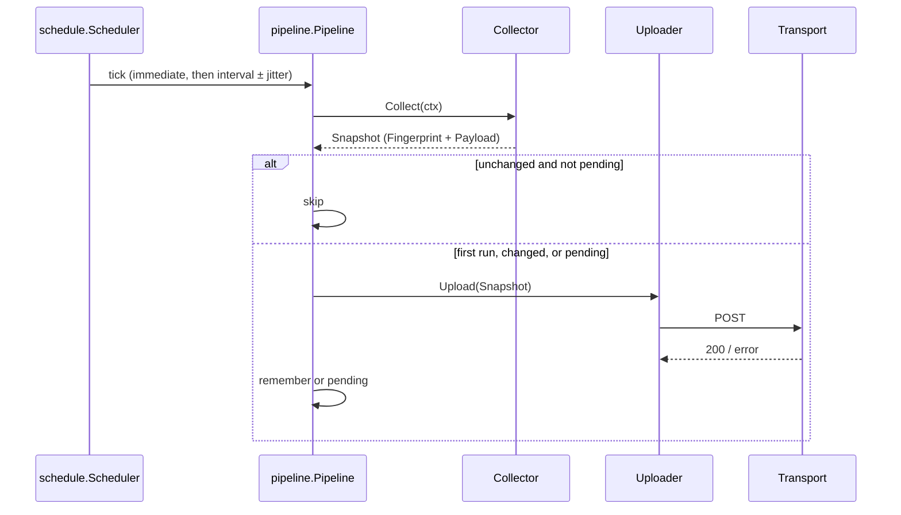

# Generic collection pipeline architecture

This document describes the **reusable collection pipeline** for the RiskLens agent.

It is not device-specific. Device inventory, Accounts, Installed Applications, Processes, Services, Network, Policies, Health, and later recurring jobs such as Browser Activity and Application Activity must all fit this model.

Phase A (OV-1.1) implements only the **scheduler**. Pipeline types (`Collector`, `Snapshot`, `Fingerprint`, `Pipeline`, `Uploader`) are specified here and implemented in a later phase. Until then, existing modules keep their current one-shot or copy-pasted tickers.

See also: [OV-1.1_DESIGN.md](OV-1.1_DESIGN.md), [DEVICE_PIPELINE.md](DEVICE_PIPELINE.md).

---

## Package names

| Package | Purpose | Status |
|---------|---------|--------|
| `agent/internal/schedule` | Shared ticker: interval, jitter, immediate first run, no overlap, Stop | **Implemented (Phase A)** |
| `agent/internal/pipeline` | Generic Collector → Snapshot → Fingerprint → compare → Uploader | **Implemented (Phase B). Device is the first host.** |

### Why `pipeline`, not `collector`

The agent already has **Collector** types inside modules (`device.Collector`, `users.Collector`, `software.Collector`). Those types talk to Windows. A top-level package named `internal/collector` would collide with that meaning and would look like “the Windows gatherer”, not the orchestrator.

**Pipeline** is the orchestrator in the product model:

```
Collector → Snapshot → Fingerprint → Pipeline → Uploader → Transport → Backend → Database → Frontend
```

The Pipeline never calls Win32 and never sees `device.Info`. It only talks to interfaces.

Device (first host) owns comparable vs transport payload and reports collection health separately from upload health. See [DEVICE_PIPELINE.md](DEVICE_PIPELINE.md). Adapters must not filter Device fields.

### Why the scheduler is `internal/schedule`, not inside `pipeline`

Heartbeat, activity, and future Browser Activity need a ticker **even when they are not using the inventory-style compare/upload pipeline**. Putting `Scheduler` in `internal/pipeline` would force those modules to import pipeline types they do not use.

`internal/schedule` matches the existing heartbeat name (`Scheduler`) and is the standard scheduling mechanism for every recurring collector. Phase B’s Pipeline will **use** `schedule.Scheduler`; it will not contain its own ticker.

`internal/inventory` was rejected: the same loop will serve Health, Policies, and activity-style jobs that are not “inventory”.

---

## End-to-end model

```
Windows / local OS
        ↓
   Collector          gathers a typed payload (device.Info, []Account, …)
        ↓
   Snapshot           generic envelope: Kind, CollectedAt, Fingerprint, Payload
        ↓
   Fingerprint        stable identity of comparable content (not sample time)
        ↓
   Pipeline           compare to last successful upload; decide skip vs upload
        ↓
   Uploader           maps Snapshot.Payload to an HTTP DTO
        ↓
   Transport          BuildRequest / Send / DecodeResponse (no net/http in modules)
        ↓
   Backend            FastAPI ingest
        ↓
   Database           latest snapshot per agent (upsert)
        ↓
   Frontend           Fleet Overview (and later Inventory tabs)
```

The Pipeline package must not import `device`, `users`, `software`, or any concrete payload type.

---

## Component responsibilities

### Collector

**What it is:** A per-kind adapter that talks to the OS (or to another in-memory source).

**What it does:**

- `Collect(ctx) (Snapshot, error)` — produce one sample
- Prefer a partial Snapshot plus error over a total failure
- Honour `ctx` cancellation
- Compute the Fingerprint for this sample (the Pipeline does not know the fields)

**What it must not do:**

- HTTP
- Scheduling
- Change detection
- Know about other collectors

Device’s `WindowsCollector` is a Collector. Users and software already have Collectors. Processes/Services/Network will add new ones. The Pipeline only sees the `pipeline.Collector` interface, never `device.Info`.

### Snapshot

**What it is:** Its own concept. A generic envelope for one sample of any kind.

**Proposed fields (Phase B):**

| Field | Meaning |
|-------|---------|
| `Kind` | Stable id: `device`, `users`, `software`, `processes`, `services`, `network`, `policies`, `health`, … |
| `CollectedAt` | When the sample was taken (UTC). **Not** part of the fingerprint. |
| `Fingerprint` | Comparable content identity |
| `Payload` | `any` — concrete type known only to the Collector and Uploader for that kind |
| `Partial` | Collector could not fill every field |
| `CollectError` | Optional explanation for Partial |

Diagnostic module state (Running / Failed / HTTP status) is **not** a Snapshot. Existing `device.Snapshot` / `deviceupload.Snapshot` names are module status machines. Do not reuse those types as pipeline Snapshots.

### Fingerprint

**What it is:** A stable hash (or typed string) of the fields that mean “this sample is the same as the last one we uploaded”.

**Rules:**

- Computed by the Collector (or a helper next to the concrete type)
- Excludes `CollectedAt` and transport metadata
- Includes fields that operators care about changing (disk free, current user, boot time, account set, …)
- List payloads must be sorted before hashing
- The Pipeline compares Fingerprint values as opaque strings. It does not interpret bits.

Device fingerprint helpers may live in the `device` package because they know `Info`. They must not live in `internal/pipeline`.

### Pipeline

**What it is:** The orchestrator. One instance per kind, each with its own `schedule.Scheduler` and interval.

**What it does each tick:**

1. `Collector.Collect`
2. If the Snapshot is empty / unusable → do not upload, do not update last success
3. Compare `Fingerprint` to last **successfully uploaded** fingerprint
4. If equal and not pending → skip Uploader
5. If different or pending → `Uploader.Upload`
6. On success → remember fingerprint, clear pending
7. On failure → set pending; do not remember a new success fingerprint

**What it must not do:**

- Import `device.Info` or any concrete inventory struct
- Own HTTP (`net/http`)
- Own a private ticker (use `schedule.Scheduler`)
- Persist to disk in OV-1.1

### Uploader

**What it is:** Per-kind HTTP adapter.

**What it does:** Turn `Snapshot.Payload` into the existing JSON DTO and send it through `transport.Transport`.

Device: today’s `deviceupload.Client` (`POST /api/v1/devices`).
Users: `POST /api/v1/users`. Software: `POST /api/v1/software`. Future kinds: new paths.

### Scheduler (`internal/schedule`)

**What it is:** Time. Not collection.

**Contract (Phase A, implemented):**

- Immediate first `Func` call (no wait, no jitter)
- Then wait `Interval ± Jitter` (jitter configurable, including zero)
- Never overlap `Func` calls; skip the tick if still in flight
- `Start` / `Stop`; Stop waits for the loop goroutine
- Parent context cancellation stops the loop and is visible to an in-flight `Func`
- Thread-safe Start/Stop (second Start is a no-op; Stop is idempotent)
- No knowledge of Snapshot, Collector, or HTTP

This is the standard scheduling mechanism for every recurring collector. Existing heartbeat/users/software/activity tickers are **not** migrated in Phase A (zero behaviour change). They should switch to `schedule.Scheduler` when those features are touched.

### Transport, backend, database, frontend

Unchanged contracts. The pipeline produces the same POSTs the backend already upserts. Frontend is not part of Phase A or of the agent pipeline package.

---

## Sequence (target, after Phase B+)



---

## Extensibility

A new Inventory tab (or later activity job that wants compare/upload) adds:

1. A Collector implementation
2. A Fingerprint for its payload type
3. An Uploader for its HTTP path
4. Construction of `pipeline.Pipeline` + `schedule.Scheduler` with that kind’s interval

No change to `internal/schedule`. No change to Pipeline internals beyond a new Kind string.

Activity that is event-driven (logon/logoff) may keep using the scheduler only for a poll/flush beat, without Fingerprint skip. That is still a valid `schedule.Func`.

---

## Phase A vs later

| Piece | Phase A | Later OV-1.1 phases |
|-------|---------|---------------------|
| `internal/schedule` | Implemented | Reused |
| `internal/pipeline` | Design only | **Phase B implemented; not wired to Device** |
| Device collect/upload | **Unchanged** (one-shot) | Recurring via Pipeline |
| Users / software tickers | **Unchanged** | Migrate when those features are production-hardened |
| Heartbeat ticker | **Unchanged** | Optional migrate |
| Backend / frontend | **Unchanged** | Unchanged for pipeline wiring |
