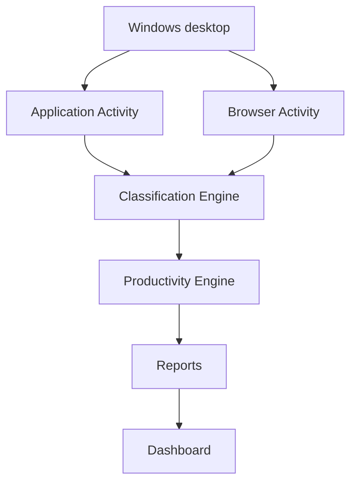
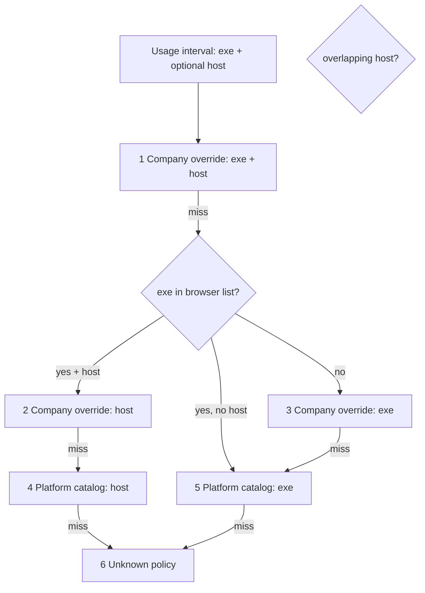
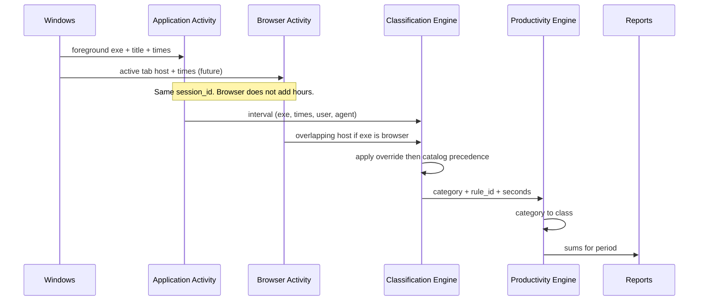

# Productivity Classification Engine — architecture

**Date:** 2026-08-21.  
**Status:** Design only. Do not implement in this task.  
**Does not change:** Windows agent, Application Activity collector/upload/schema, Browser Activity (still unimplemented), database, APIs, UI.

---

## Why this exists

Classifying productivity from the executable alone is false.

`chrome.exe` is not a category. It is a **container**. The same process can be:

| Foreground | Intended category | Intended class |
|---|---|---|
| office.com | Office | Productive |
| github.com | Development | Productive |
| jira.company.com | Project management | Productive |
| chat.openai.com | AI tools | Productive |
| youtube.com | Entertainment | Unproductive (default) |
| netflix.com | Entertainment | Unproductive |
| facebook.com | Social | Unproductive |

Desktop applications *can* be classified from the executable (`Code.exe` → Development). Browsers cannot.

**Rule:** Browser Activity **enriches** Application Activity. It does not replace it, and it is not a second clock.

---

## Current state (do not pretend otherwise)

| Layer | Today |
|---|---|
| Windows foreground | Live. `GetForegroundWindow` → exe + window title, ~15s segments |
| Application Activity | Live. Table `application_activity`. No URL. No category |
| Browser Activity | **Not implemented.** Fleet tab is a stub. No collector, API, or table |
| Classification | Does not exist |
| Productivity / Reports / Dashboard | Placeholders. No scores |

Window title is **not** a substitute for Browser Activity. Titles such as `Types of Computer Networks - GeeksforGeeks - Google Chrome` are unstable, truncated, localized, and often missing the registrable domain. Classification must wait for a real active-tab URL (or equivalent) from a future Browser Activity collector.

This document designs the engine that will sit **on top of** those two activity streams once Browser Activity exists. It does not specify how to collect browser URLs (that is a later Browser Activity design).

---

## Product pipeline



| Stage | Owns | Does not own |
|---|---|---|
| Windows | Foreground process, active tab URL (future) | Categories, scores |
| Application Activity | One segment: who, which exe, which title, when | Domain, category |
| Browser Activity | Active tab of the **foreground** browser: domain/URL, when | Desktop apps, scores |
| Classification Engine | Map a **usage interval** → category + rule id | Time math, UI |
| Productivity Engine | Map category → Productive / Neutral / Unproductive / Ignored; sum time | Collectors |
| Reports | Period rollups per employee / computer / category / class | Live Fleet table |
| Dashboard | Manager snapshot of classified time | Raw segment log |

Application Activity (Fleet tab) stays a **real-time monitor** of foreground segments. Productivity is a **derived** product. Do not replace the activity table with a rollup.

---

## 1. How desktop applications are classified

**Key:** normalized executable basename, case-insensitive (`code.exe`, `Cursor.exe`, `EXCEL.EXE`).

Optional later keys (not required for v1): Product Name from version resources, signed publisher, full image path. v1 uses **executable only** for non-browser apps.

### Default catalog (platform seed)

| Example | Executable (typical) | Category | Default class |
|---|---|---|---|
| VS Code | `Code.exe` | Development | Productive |
| Cursor | `Cursor.exe` | Development | Productive |
| Excel | `EXCEL.EXE` | Office | Productive |
| Word | `WINWORD.EXE` | Office | Productive |
| Teams | `ms-teams.exe` / `Teams.exe` | Communication | Productive |
| Slack | `slack.exe` | Communication | Productive |
| Outlook | `OUTLOOK.EXE` | Email | Productive |

Communication tools default to **Productive**. A company that treats chat as Neutral remaps the **category** `communication` → Neutral in company settings (one row), not every executable.

### System / shell (Ignored)

These are foreground often and are not “work” or “slacking”:

`explorer.exe`, `SearchHost.exe`, `LockApp.exe`, `dwm.exe`, `ApplicationFrameHost.exe`, `SystemSettings.exe`, `ShellExperienceHost.exe`, `sihost.exe`, `TextInputHost.exe`, `LogonUI.exe`.

Category: `system`. Class: **Ignored (System)**.

`cmd.exe` / `WindowsTerminal.exe` / `powershell.exe` default to **Development / Productive**. A helpdesk company may leave them Productive; an office-only company may remap to Neutral.

### Unknown desktop application

See §5. Do **not** treat unknown exe as Unproductive.

---

## 2. How Browser Activity is classified

**Key:** registrable domain (eTLD+1), lowercased. Not the full URL path.

| Input | Stored key |
|---|---|
| `https://github.com/org/repo/pull/12` | `github.com` |
| `https://jira.company.com/browse/ABC-1` | `jira.company.com` (host; company may also add suffix rule `*.company.com`) |
| `https://chat.openai.com/` | `chatgpt.com` / `openai.com` as catalogued (alias rows) |

Path, query, and fragment are **not** used for classification (privacy + stability). They may be stored hashed or omitted by the future Browser Activity design; this engine only needs **host**.

### Default catalog (platform seed)

| Example | Domain key | Category | Default class |
|---|---|---|---|
| office.com | `office.com`, `microsoft365.com`, `live.com` (office hosts) | Office | Productive |
| github.com | `github.com` | Development | Productive |
| jira.company.com | host or `*.company.com` via company rule | Project management | Productive |
| chat.openai.com | `openai.com`, `chatgpt.com` | AI tools | Productive |
| salesforce.com | `salesforce.com`, `force.com` | CRM | Productive |
| gmail.com | `gmail.com`, `mail.google.com` | Email | Productive |
| youtube.com | `youtube.com` | Entertainment | Unproductive |
| facebook.com | `facebook.com` | Social | Unproductive |
| netflix.com | `netflix.com` | Entertainment | Unproductive |

**Gmail / YouTube are policy-sensitive.** Defaults above are a starting catalog, not moral facts.

- Gmail is Email / Productive because many companies live in Google Workspace. A company that wants “webmail = personal” remaps `gmail.com` → Neutral or Unproductive.
- YouTube is Entertainment / Unproductive because the common case is not training. A training org remaps `youtube.com` → Neutral or Productive.

Never encode those debates in collector code. Encode them in **company overrides**.

### What Browser Activity must emit (constraint on a future collector)

For this engine to work, Browser Activity must be **the active tab of the foreground browser window**, time-bounded, attached to the same `session_id` as Application Activity.

It must **not** be:

- Full history of all tabs
- Background YouTube while GitHub is focused
- Extension-wide “all open URLs”

If the collector reports every open tab, classification will double-count and smear Unproductive over real work. That is a Browser Activity contract, not a Classification Engine feature. This document assumes the contract. It does not implement the collector.

---

## 3. Which source has priority?

### Example

| Field | Value |
|---|---|
| Application Activity | `chrome.exe` |
| Browser Activity (overlapping) | `github.com` |

**Category is Development, not Browser.**  
**Class is Productive.**

`chrome.exe` only answers “the container is a browser.” `github.com` answers “the work is development.”

### One clock

Application Activity segments are the **time source**. Browser Activity is a **label source** for intervals where the foreground executable is a known browser.

Do **not** sum Application time and Browser time. One hour in Chrome on GitHub is one hour of Development, not two.

```text
classified_seconds(interval) = application_activity_seconds(interval)
label(interval)              = f(exe, overlapping_browser_host, catalogs, overrides)
```

### Browser executable list (platform)

Treat as browsers (container, not category):  
`chrome.exe`, `msedge.exe`, `firefox.exe`, `brave.exe`, `opera.exe`, `vivaldi.exe`, `iexplore.exe`, plus company-added browsers.

### Precedence (highest wins)



| Priority | Rule | Example result |
|---|---|---|
| 1 | Company override on **(executable, host)** | `chrome.exe` + `youtube.com` → Training / Productive for one tenant |
| 2 | Company override on **host** | `github.com` → Development even in Edge |
| 3 | Company override on **exe** (non-browser, or browser with no host) | `slack.exe` → Neutral |
| 4 | Platform domain catalog | `github.com` → Development |
| 5 | Platform executable catalog | `Code.exe` → Development; `chrome.exe` with **no** host → Browser / Neutral |
| 6 | Unknown policy | Unclassified / Neutral |

### Detailed chrome + GitHub walk

1. Interval from Application Activity: `chrome.exe`, 10:00–10:20, session S.  
2. Overlapping Browser Activity: host `github.com`, 10:00–10:20, session S.  
3. `chrome.exe` is in the browser list → **do not** stop at “Browser.”  
4. No company pair override.  
5. Host `github.com` hits platform catalog → category `development`.  
6. Productivity Engine: `development` → Productive.  
7. Report: 20 minutes Development / Productive for that username.

### Detailed chrome + YouTube walk

Same flow; host `youtube.com` → `entertainment` → Unproductive (unless company remaps).

### Detailed Cursor walk

1. Exe `Cursor.exe`, not a browser.  
2. Browser Activity is ignored even if a browser exists in the background.  
3. Platform exe catalog → `development` → Productive.

### Browser with no Browser Activity (gap)

Until Browser Activity exists, or if the collector failed:

- Exe is a known browser  
- No overlapping host  

**Fallback:** category `browser`, class **Neutral**, reason `missing_browser_activity`.

Do **not** parse window title as a URL in v1. Do **not** mark Unproductive. Missing data is Neutral, not guilt.

### Non-browser with a host (should not happen)

If join code attaches a host to `Code.exe`, **ignore the host**. Desktop exe rules win. Host is only consulted when exe ∈ browser list (or company marked that exe as `container=browser`).

---

## 4. Unknown websites

| Policy | Value |
|---|---|
| Category | `unclassified` |
| Class | **Neutral** |
| Reason code | `unknown_domain` |
| Manager view | “Needs review” queue (domain, time spent, sample employees) |
| Not allowed | Auto-Unproductive, auto-Productive, ML guess in v1 |

Unknown ≠ bad. New SaaS, staging hosts (`jira-dev.internal`), and regional CDNs would poison scores if unknown meant Unproductive.

After a company maps the domain, **rebuild** classified time (see data model). Historical Neutral becomes Productive/Unproductive from the mapping’s `effective_from` (default: apply retroactively for the current reporting period unless the company sets otherwise).

---

## 5. Unknown desktop applications

| Policy | Value |
|---|---|
| Category | `unclassified` |
| Class | **Neutral** |
| Reason code | `unknown_executable` |
| Manager view | Same review queue (exe, publisher if later available, time) |
| System list miss | If we failed to seed `LockApp.exe`, it looks “unknown.” Keep the system catalog complete; still Neutral until listed |

Portable tools, in-house `.exe` names, and versioned installers (`app-1.2.3.exe`) will miss the platform catalog. That is expected. Company overrides and the review queue are the product, not a bigger hardcoded list.

---

## 6. How companies customize classifications

### Recommendation (long-term)

**Database is the source of truth.**  
**JSON/YAML is the seed and the export format.**  
**Admin UI is the operator surface.**  
**Config files are bootstrap only** (on-prem first boot), not the live mapping.

| Store | Role | Why |
|---|---|---|
| Platform seed JSON (shipped in product) | Default catalogs: browsers, system exes, well-known domains, category→class | Versioned, reviewed, same for all tenants until overridden |
| PostgreSQL company tables | Overrides, custom apps, custom domains, category remaps, aliases | Queryable, auditable, no deploy to change a site |
| Admin UI | CRUD + CSV import + “review queue” | Managers will not edit JSON in production |
| Agent YAML / env | **Out of scope** | Classification is a platform concern; agents must not carry tenant policy |

Do **not** put mappings in the Windows agent. Changing “YouTube is training” must not require an MSI rebuild or a new agent version.

Do **not** keep live mappings only in JSON on disk. That does not scale to per-company edits, audit, or multi-tenant.

### Suggested company operations (UI, later)

- Map domain → category  
- Map executable → category  
- Map (browser exe + domain) → category (exception)  
- Map category → class (e.g. all Communication → Neutral)  
- Add alias: `chatgpt.com` = `openai.com`  
- Suffix rule: `*.corp.example.com` → Internal / Productive  
- Import CSV: `domain,category,class`  
- Export current effective catalog  

### Precedence with company data

Company row **replaces** platform seed for that key. It does not delete the seed. Removing the override restores the platform default.

---

## 7. How productivity is calculated

### Two-layer model

```text
usage interval
    → Classification Engine → category
    → Productivity Engine  → class ∈ {Productive, Neutral, Unproductive, Ignored}
```

Categories are **taxonomy**. Classes are **scoring**. Companies remap class without renaming GitHub.

Default category → class (platform seed; company-overridable):

| Category | Default class |
|---|---|
| Development | Productive |
| Office | Productive |
| Communication | Productive |
| Email | Productive |
| Project management | Productive |
| CRM | Productive |
| ERP | Productive |
| AI tools | Productive |
| Internal | Productive |
| Browser (no host) | Neutral |
| Unclassified | Neutral |
| Entertainment | Unproductive |
| Social | Unproductive |
| Shopping | Unproductive |
| System | Ignored |

### Time math

For each classified interval:

```text
seconds = max(0, (COALESCE(stopped_at, report_now) - started_at))
```

Same wall-clock rule Application Activity already uses. **Idle, lock, and AFK are not subtracted in v1.** Session lock events exist on the agent as timeline-only today; wiring them into productivity is a later honesty upgrade, not this engine’s v1.

Aggregate:

```text
T_p  = Σ seconds WHERE class = Productive
T_n  = Σ seconds WHERE class = Neutral
T_u  = Σ seconds WHERE class = Unproductive
T_i  = Σ seconds WHERE class = Ignored
T_scored = T_p + T_n + T_u
```

| Metric | Formula | Use |
|---|---|---|
| Productive time | `T_p` | Reports |
| Neutral time | `T_n` | Reports, review |
| Unproductive time | `T_u` | Reports |
| Ignored time | `T_i` | Shown separately; **not** in % |
| Productivity % | `T_p / T_scored` if `T_scored > 0` else null | Dashboard |
| Unproductive % | `T_u / T_scored` | Dashboard |

Ignored (lock screen, explorer) must not shrink or inflate productivity %. A user locked for 4 hours and working 1 hour Productive is **100% of scored time**, with 4 hours Ignored called out as presence, not as work.

### Grain

| Grain | Meaning |
|---|---|
| Interval | One classified slice (usually one Application Activity segment, possibly split if the active tab changes inside one exe+title segment) |
| Employee | `computer_sessions.username` (Windows account), not HR employee id |
| Computer | `agent_id` |
| Period | Report `from` / `to` on `started_at` (document: segment counted in full if it starts in window — same first-cut rule as other time reports unless a later design clips) |

If Browser Activity changes host while Application Activity keeps the same exe+title (user switched tabs, title unchanged), **split** the application interval at host-change timestamps so GitHub and YouTube in the same Chrome window are not one blob. If title already changes per site (common), Application Activity already split; join 1:1.

### What Reports show

- Time by class (four buckets)  
- Time by category (Development, Entertainment, …)  
- Top domains and top executables **after** classification  
- Unclassified review list  

Dashboard is a thin view of the same aggregates (company or group scope). It does not classify.

---

## Classification flow (end-to-end)



**Join key:** `session_id` + time overlap + exe ∈ browser list.

**Join failure:** classify as browser/Neutral with `missing_browser_activity`.

---

## Recommended data model

**Do not create these tables in this task.** Design only.

Classification is **derived**. Do not write category onto `application_activity` at ingest. Mapping changes must not require agents to re-upload.

### Platform seed (files in repo, loaded to DB on migrate/seed)

Logical documents, not live edit:

- `classification_browsers` — exe → `container=browser`  
- `classification_system_executables` — exe → category `system`  
- `classification_executables` — exe → category  
- `classification_domains` — host or suffix → category  
- `classification_domain_aliases` — `chatgpt.com` → `openai.com`  
- `classification_category_class` — category → default class  

### Company tables (PostgreSQL, later)

```text
company_classification_executable
  company_id, executable_key, category, class_override nullable,
  effective_from, updated_by, updated_at

company_classification_domain
  company_id, host_or_suffix, match_type (exact|suffix),
  category, class_override nullable, ...

company_classification_pair
  company_id, executable_key, host_or_suffix, category, class_override nullable, ...

company_category_class
  company_id, category, class
```

`executable_key` = lower(trim(basename)).  
`host_or_suffix` = lower(trim(host)) or `*.corp.example.com`.

Single-tenant v1 may omit `company_id` and use one implicit company. Keep the column in the design so SaaS does not fork the model.

### Derived classified intervals (materialized, rebuildable)

```text
classified_usage_interval
  id
  session_id, agent_id, username
  started_at, stopped_at, seconds
  executable_name, window_title
  browser_host              -- null if desktop or missing
  category
  productivity_class
  rule_id                   -- which precedence step fired
  source_application_id     -- FK-ish to application_activity.id
  source_browser_id         -- nullable
  classified_at
```

Rebuild job: delete/replace intervals for a period when catalogs or overrides change. Reports read **only** this table (or a daily rollup on top of it).

### What we explicitly do not store

- Productivity score on the agent  
- Category on the raw `application_activity` row as source of truth  
- Full URL in classification keys  

---

## 8. Future extensibility (no code change)

Customers add assets through **data**, not releases.

| Customer want | Mechanism |
|---|---|
| Internal websites | Domain or suffix override: `jira.company.com`, `*.corp.example.com` → Internal / Productive |
| Internal desktop apps | Executable override: `AcmeERP.exe` → ERP / Productive |
| AI tools | Domain catalog + aliases (`openai.com`, `claude.ai`, `gemini.google.com`) and/or exe (`Cursor.exe` already Development). New tools: insert rows |
| ERP / CRM | Domain + exe rows (`salesforce.com`, `saplogon.exe`) → categories `crm` / `erp` |
| “YouTube is training” | Domain override or pair override; or remap category Entertainment → Neutral (coarse) |
| New browser | Add exe to browser-container list (company or platform seed) so host rules apply |
| Chat is Neutral | `company_category_class`: `communication` → Neutral |

Admin UI + CSV import are enough for v1 extensibility. A public “classification API” can come later; it is the same tables.

Platform seed updates (new default SaaS domains) ship as product versions and **must not overwrite** company overrides.

---

## Layer responsibilities (frozen)

| Must not | Why |
|---|---|
| Agent classifies productivity | Policy would be stuck in MSI; tenants differ |
| Application Activity store URLs | Wrong module; exe+title is the contract today |
| Browser Activity emit scores | It is a sensor |
| Dashboard implement catalogs | It displays Productivity Engine output |
| Double-count browser + app hours | False utilization |

---

## Risks

| Risk | Effect | Mitigation |
|---|---|---|
| Browser Activity not built | All Chrome time stays Neutral `browser` | Ship classification after active-tab collector; do not fake URLs from titles |
| Background tabs reported | YouTube leaks into GitHub time | Collector contract: active tab only |
| Personal vs work Gmail | Unfair Productive or Unproductive | Company remap; Neutral default if disputed |
| YouTube-as-training | False Unproductive | Company override; review queue by hours |
| Unknown SaaS | Large Neutral bucket | Review queue sorted by time |
| Join clock skew / 15s sampling | Host attached to wrong minute | Overlap join; tolerate ± interval; do not require exact timestamps |
| Multiple ACTIVE sessions | Wrong username or duplicate time | Existing session lifecycle bug; classification inherits it; fix sessions separately |
| Idle not subtracted | Overstated work | v1 honesty in UI copy; later lock/idle subtraction |
| Privacy (full URLs) | Legal / trust | Classify on host; minimize URL retention in Browser Activity design |
| Catalog maintenance | Missed exes (`ms-teams.exe` vs `Teams.exe`) | Aliases; unknown queue; publisher later |
| Reclassification cost | Rebuild job on large `application_activity` | Period-partitioned rebuild; indexes on `(agent_id, started_at)` already exist |

---

## Verification plan

No code in this task. When implemented, prove:

1. **Desktop:** `Cursor.exe` / `Code.exe` → Development / Productive with no browser row.  
2. **Browser enrich:** `chrome.exe` + `github.com` → Development / Productive, not Browser.  
3. **Browser unproductive default:** `chrome.exe` + `youtube.com` → Entertainment / Unproductive.  
4. **Company remap:** same YouTube interval → Neutral or Productive after override; rebuild updates reports.  
5. **Unknown host:** `random-saas.example` → Unclassified / Neutral, appears on review queue.  
6. **Unknown exe:** `AcmeTool.exe` → Unclassified / Neutral.  
7. **System:** `LockApp.exe` → Ignored; excluded from productivity %.  
8. **No double count:** 60 minutes Chrome+GitHub → 60 minutes scored, not 120.  
9. **Missing browser module:** `chrome.exe` only → Browser / Neutral, not Unproductive.  
10. **Non-browser ignores host:** if a host is wrongly joined to `EXCEL.EXE`, still Office.  
11. **Application Activity UI unchanged:** Fleet tab still raw real-time segments.  
12. **Agent unchanged:** no classification fields in upload payload.

---

## Definition of Done (when a later sprint implements this)

The Classification Engine is done when:

1. Browser Activity provides **active-tab host** aligned to `session_id` and time (separate design/implementation).  
2. Classification uses the precedence table in §3.  
3. Desktop apps classify from executable catalogs; browsers classify from host when present.  
4. Unknown exe and unknown host are Neutral / Unclassified, never auto-Unproductive.  
5. Company overrides live in the database and win over platform seed; no agent change required.  
6. Productivity % uses Productive / (Productive + Neutral + Unproductive); Ignored excluded.  
7. Reports read rebuildable classified intervals, not ad-hoc exe grouping.  
8. Copy does not claim idle-adjusted time.  
9. Application Activity and Browser Activity sensors remain classification-free.  
10. Tests cover chrome+github, chrome+youtube, Cursor, unknown, ignored, and no double-count.

**Not required for this document:** collector work, tables, APIs, UI, Application Summary, or any code.

---

## Decision summary

| Topic | Decision |
|---|---|
| Time source | Application Activity intervals only |
| Browser role | Enrichment (active tab host), not a second clock |
| chrome + github.com | Development / Productive |
| chrome + youtube.com | Entertainment / Unproductive (company-overridable) |
| chrome, no host | Browser / Neutral |
| Unknown anything | Neutral + review queue |
| System shell | Ignored; out of % |
| Customization | DB overrides + Admin UI; JSON seed; not agent config |
| Scores on ingest | No; derived + rebuildable |

**Stop.** Architecture only. Do not implement.
