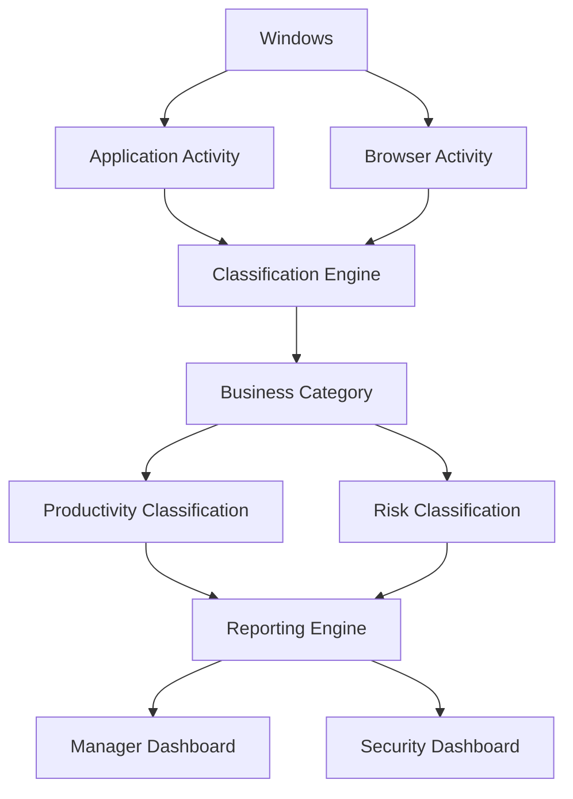
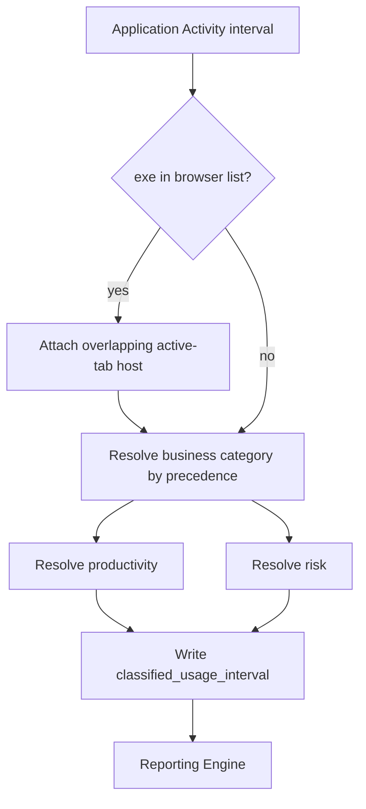

# Productivity Classification V2 — enterprise specification

**Date:** 2026-08-21.  
**Status:** Architecture only. Do not implement.  
**Supersedes for design:** [PRODUCTIVITY_CLASSIFICATION_ARCHITECTURE.md](PRODUCTIVITY_CLASSIFICATION_ARCHITECTURE.md) (V1). V1 remains the approved baseline; this document is the long-term enterprise refinement.  
**Does not change:** agent, Application Activity, Browser Activity, database, APIs, UI.

---

## Purpose

One classified activity stream must feed:

- Employee / team / department / organization **productivity** reporting  
- **Manager Dashboard** (how time was spent)  
- **Security Dashboard** (what was used that is risky)

The sensors stay dumb. Policy lives on the platform. The agent never carries company mappings.

---

## Non-negotiable rules

1. **Application Activity is the clock.** Seconds come from foreground application intervals.  
2. **Browser Activity is a label.** It never adds hours. It only names the active tab of a foreground browser.  
3. **Business category, productivity class, and risk are three independent attributes** of the same interval.  
4. A company can change productivity or risk **without** renaming the category.  
5. Unknown is **not guilt.** Unknown executable → category `Other`, productivity Neutral, risk Medium (until reviewed). Unknown website → productivity Neutral.  
6. Fleet → Application Activity remains a **real-time monitor**. This engine does not replace that page.

---

## Current platform (honest)

| Piece | Today |
|---|---|
| Application Activity | Live. Exe + window title + times. No URL, category, productivity, or risk |
| Browser Activity | Not implemented |
| Groups / department | Reserved. No team org-chart |
| HR employee id | Does not exist. Identity is Windows `username` on the session |
| File signature / Authenticode | Not on activity rows |
| Reports / dashboards | Placeholders |

V2 is designed so those gaps can be filled **as data**, not as a second product.

---

## Complete pipeline



Same interval, three labels, many reports.

```text
classified_usage_interval
  seconds              ← Application Activity only
  executable
  browser_host         ← null unless foreground exe is a browser
  business_category    ← Level 3
  productivity_class   ← Level 4
  risk_level           ← Level 5
  rule_ids             ← why each label was chosen
```

Manager Dashboard reads `productivity_class` + `business_category` + `seconds`.  
Security Dashboard reads `risk_level` + `business_category` + asset identity + `seconds`.  
Neither dashboard classifies. Both read the Reporting Engine.

---

## Data ownership

| Layer | Owns | Must not own |
|---|---|---|
| Windows / agent | Foreground exe, title, times; future active-tab host | Category, productivity, risk, company policy |
| Application Activity | Usage intervals (who, which process, when) | URLs, scores |
| Browser Activity | Active tab host overlapping a browser interval | Extra time, scores |
| Classification Engine | Resolve catalog + overrides → category | UI, HR org chart |
| Productivity mapping | Category (or asset override) → Productive / Neutral / Unproductive / Ignored | Collectors |
| Risk mapping | Category or asset → Low / Medium / High | Collectors |
| Reporting Engine | Period aggregates at employee / team / department / org | Raw sensor format |
| Manager Dashboard | Productivity views | SOC triage |
| Security Dashboard | Risk views | Performance reviews |
| Admin UI | Company overrides | Agent config |
| JSON seed | Platform defaults | Live tenant edits |
| PostgreSQL | Source of truth for effective mappings + classified intervals | MSI payloads |

**Agent YAML is not a mapping store.** Changing “YouTube is training” or “Mega is High risk” must never require an agent release.

---

# Level 1 — Activity source

Every scored second starts as an Application Activity interval.

### Desktop applications (classify from executable)

Normalized key: `lower(basename(image))`.

| Example | Typical executable | Default category |
|---|---|---|
| VS Code | `Code.exe` | Development |
| Cursor | `Cursor.exe` | Development |
| Excel | `EXCEL.EXE` | Office |
| Word | `WINWORD.EXE` | Office |
| Teams | `ms-teams.exe`, `Teams.exe` | Communication |
| Slack | `slack.exe` | Communication |
| Outlook | `OUTLOOK.EXE` | Communication (email client; see category note) |

Outlook is **Communication** in the V2 taxonomy (email is a communication channel). Companies that want a distinct Email bucket can add a company category later; the platform seed stays in the list below.

### Browser applications (containers, not categories)

| Example | Typical executable |
|---|---|
| Chrome | `chrome.exe` |
| Edge | `msedge.exe` |
| Firefox | `firefox.exe` |

Also seed: `brave.exe`, `opera.exe`, `vivaldi.exe`. Company can mark additional exes as `container = browser`.

A browser executable **does not** receive category `Browser` when a host is known. `Browser` is the fallback category only when the container is a browser and **no** overlapping host exists.

### System (not work)

`explorer.exe`, `SearchHost.exe`, `LockApp.exe`, `dwm.exe`, `ApplicationFrameHost.exe`, `SystemSettings.exe`, `LogonUI.exe`, and similar shell hosts → category `System`.

---

# Level 2 — Browser domain enrichment

Browser Activity attaches a **host** to an existing browser interval.

```text
if executable ∈ browser_containers
   and browser_activity overlaps session_id + time
then
   interval.browser_host = registrable_or_full_host(active_tab)
else
   interval.browser_host = null
```

**Never:**

- Add `browser_seconds` to `application_seconds`  
- Classify from all open tabs  
- Use window title as a URL in v1  

### Domain examples → intended business category (platform seed)

| Host | Category |
|---|---|
| `github.com`, `gitlab.com` | Development |
| `office.com`, `microsoft365.com` | Office |
| `jira.company.com`, `atlassian.net` | Project Management |
| `chat.openai.com`, `chatgpt.com`, `claude.ai`, `gemini.google.com` | AI Assistant |
| `salesforce.com`, `force.com` | CRM |
| `google.com` (search / generic) | Research |
| `youtube.com` | Entertainment |
| `facebook.com` | Social Media |
| `linkedin.com` | Social Media (sales orgs remap to Communication or CRM) |
| `netflix.com` | Streaming |
| `internal.company.com`, `*.corp.example.com` | company-defined, typically Internal mapped to a business category or `Other` until named |
| `dropbox.com` | File Sharing |
| `mega.nz` | File Sharing |

Host matching uses lowercased host. Suffix rules (`*.company.com`) are company data, not agent data.

If the tab changes inside one Application Activity segment, **split** the interval at host-change times so GitHub and YouTube are not one blob. Time still sums to the original application seconds.

---

# Level 3 — Business category

Categories describe **what kind of work or site this is**. They are stable names for reports. They are not scores.

### Platform category list

| ID | Category | Typical sources |
|---|---|---|
| `development` | Development | IDEs, GitHub, GitLab, localhost admin of code hosts |
| `office` | Office | Word, Excel, PowerPoint, Microsoft 365, Google Docs |
| `communication` | Communication | Teams, Slack, Outlook, Zoom |
| `project_management` | Project Management | Jira, Linear, Asana, Azure Boards |
| `crm` | CRM | Salesforce, HubSpot |
| `erp` | ERP | SAP GUI, Oracle EBS |
| `finance` | Finance | NetSuite, banking consoles, Excel does **not** auto-move here |
| `hr` | HR | Workday, BambooHR, SuccessFactors |
| `ai_assistant` | AI Assistant | ChatGPT, Claude, Gemini, Copilot web |
| `research` | Research | Generic search (`google.com`), Wikipedia, documentation sites |
| `browser` | Browser | Browser exe **with no host** |
| `entertainment` | Entertainment | YouTube (default), games-adjacent web not in Gaming |
| `social_media` | Social Media | Facebook, Instagram, X, LinkedIn (default) |
| `streaming` | Streaming | Netflix, Disney+, Twitch |
| `gaming` | Gaming | Steam, Epic, game exes |
| `file_sharing` | File Sharing | Dropbox, Google Drive web, Mega, WeTransfer |
| `system` | System | Shell, lock, search host |
| `other` | Other | Unknown exe, unknown domain, unmapped internal |

### How desktop apps map

Executable catalog: `code.exe` → `development`, `excel.exe` → `office`, `teams.exe` → `communication`, `explorer.exe` → `system`.

No host is consulted unless the exe is a browser container.

### How browser domains map

Host catalog (and suffix rules) run **only** when the exe is a browser container.

`chrome.exe` + `github.com` → `development`.  
`chrome.exe` + `salesforce.com` → `crm`.  
`chrome.exe` + no host → `browser`.

Cursor in the foreground never becomes `ai_assistant` just because ChatGPT is open in a background tab.

---

# Level 4 — Productivity

Productivity is a **policy label**, not a synonym of category.

```text
productivity_class ∈ { Productive, Neutral, Unproductive, Ignored }
```

### Default category → productivity (platform seed)

| Category | Default productivity |
|---|---|
| Development | Productive |
| Office | Productive |
| Communication | Productive |
| Project Management | Productive |
| CRM | Productive |
| ERP | Productive |
| Finance | Productive |
| HR | Productive |
| AI Assistant | Productive |
| Research | Neutral |
| Browser | Neutral |
| Entertainment | Unproductive |
| Social Media | Unproductive |
| Streaming | Unproductive |
| Gaming | Unproductive |
| File Sharing | Neutral |
| System | Ignored |
| Other | Neutral |

**AI Assistant is the canonical split example.** Seed is Productive. A company that forbids public LLMs sets:

- category stays `ai_assistant`  
- `company_category_productivity.ai_assistant = Unproductive` (or Neutral)

Reports still show “AI Assistant” hours. The score changes. GitHub does not get renamed.

Asset-level productivity override is allowed (YouTube → Productive for a training tenant) without changing the Entertainment category for Netflix.

### Time math

```text
seconds = max(0, COALESCE(stopped_at, report_now) - started_at)   # application interval
T_p, T_n, T_u, T_i = sums by productivity_class
T_scored = T_p + T_n + T_u
productivity_pct = T_p / T_scored     # null if T_scored = 0
```

**Ignored is excluded from %.** Lock screen must not look like unproductive work.

v1 does **not** subtract idle. UI copy must not claim idle-adjusted time.

---

# Level 5 — Risk

Risk is a **security label** on the same interval. It is not the inverse of productivity.

GitHub can be Productive and **Low** risk.  
Mega can be Neutral productivity and **High** risk.  
Unknown unsigned tools can be Neutral productivity and **High** risk.

```text
risk_level ∈ { Low, Medium, High }
```

Critical can be added later; V2 ships three levels to match operations language.

### Default category → risk (platform seed)

| Category | Default risk | Rationale |
|---|---|---|
| Development | Low | Expected for builders; exceptions on shadow IT |
| Office | Low | |
| Communication | Low | |
| Project Management | Low | |
| CRM / ERP / Finance / HR | Low | Data-sensitive but sanctioned |
| AI Assistant | Medium | Data-exfil via prompts; company may raise to High |
| Research | Low | |
| Browser (no host) | Medium | Unseen destination |
| Entertainment / Social / Streaming / Gaming | Low | Usually not malware; SOC may still watch volume |
| File Sharing | Medium | Exfil path; **asset overrides** raise Mega |
| System | Low | |
| Other | Medium | Unknown |

### Asset-level risk (wins over category default)

| Asset | Risk | Why |
|---|---|---|
| `github.com` / `gitlab.com` | Low | Sanctioned code host (company can raise if GitHub is unsanctioned) |
| `dropbox.com` | Medium | Consumer file share; often unsanctioned |
| `mega.nz` | High | Common unsanctioned exfil |
| Unknown executable | Medium | Not yet reviewed |
| Unsigned executable | High | When signature enrichment exists |
| Unknown browser host | Medium | Same as Other / unseen destination |

Unsigned is **not available from Application Activity today**. V2 records it as a **future enrichment**:

1. Join process image to Authenticode (future agent field or platform file-inspect job).  
2. Until then, unknown exe uses **Medium**, not High. Do not invent High from missing data.

Software inventory publisher is a weak proxy (installed ≠ the running unsigned binary). Do not treat `software_inventory` as signature.

### Manager vs SOC — same activity, different slice

| | Manager Dashboard | Security Dashboard (SOC) |
|---|---|---|
| Question | Was this time productive for the role? | Was this usage an approved / risky channel? |
| Primary fields | `productivity_class`, category, seconds | `risk_level`, category, host/exe, seconds |
| Example | 2h GitHub = Productive Development | 2h GitHub = Low, sanctioned code host |
| Example | 20m Mega = Neutral File Sharing | 20m Mega = High unsanctioned transfer |
| Example | 1h unknown `tool.exe` = Neutral Other | 1h unknown exe = Medium, review; High if unsigned |
| Must not | Treat High risk as Unproductive automatically | Treat Unproductive YouTube as an incident |

A SOC analyst should not need a second collector. They need the Reporting Engine filtered by `risk_level >= Medium`, File Sharing, AI Assistant, Other, and unsigned flags.

---

# Precedence rules

Apply **once per interval**, then derive productivity and risk from the resolved category unless a more specific override exists.

### Resolve business category

Highest wins:

| Priority | Rule | Result examples |
|---|---|---|
| 1 | Company pair override `(exe, host)` | `chrome.exe` + `youtube.com` → Research (training tenant) |
| 2 | Company host / suffix override | `*.company.com` → Project Management |
| 3 | Company executable override | `AcmeERP.exe` → ERP |
| 4 | Platform host catalog (only if exe is browser container and host present) | `chrome.exe` + `github.com` → **Development, not Browser** |
| 5 | Platform executable catalog | `Code.exe` → Development; `explorer.exe` → System |
| 6 | Defaults | Browser container, no host → **Browser**; unknown exe → **Other**; unknown host → **Other** |

### Then productivity

| Priority | Rule |
|---|---|
| 1 | Company pair or asset productivity override |
| 2 | Company category → productivity |
| 3 | Platform category → productivity |

Unknown host: if category is `Other`, productivity is **Neutral** (platform). Do not use Unproductive.

### Then risk

| Priority | Rule |
|---|---|
| 1 | Company pair or asset risk override (`mega.nz` → High) |
| 2 | Unsigned flag → High (when enrichment exists) |
| 3 | Unknown executable → Medium (if no other asset rule) |
| 4 | Company category → risk |
| 5 | Platform category → risk |

### Walkthroughs (normative)

**`chrome.exe` + `github.com`**  
Container browser → host catalog → category Development → productivity Productive → risk Low.  
Not Browser.

**`Code.exe`**  
Not a container → exe catalog → Development → Productive → Low.  
Host ignored if present.

**`explorer.exe`**  
System → Ignored → risk Low. Out of productivity %.

**Unknown executable**  
Category Other → Neutral → risk Medium.

**Unknown browser domain** (`chrome.exe` + `new-saas.example`)  
Category Other → productivity **Neutral** → risk Medium.  
Not Unproductive. Not Browser (we *have* a host; we just have no catalog row).

**`chrome.exe` and no Browser Activity**  
Category Browser → Neutral → risk Medium (`missing_browser_activity`).

---

# Customization model

### Source of truth

**PostgreSQL company mapping tables are the source of truth** for runtime classification.

| Store | Role |
|---|---|
| JSON/YAML seed in the product | Platform defaults (categories, browsers, system exes, well-known domains, default productivity, default risk) |
| Database | Effective tenant mappings, overrides, aliases, suffix rules, audit (who/when) |
| Admin UI | How operators edit the database |
| CSV import/export | Bulk internal apps and sites |
| Agent config | **Forbidden** for mappings |
| App config / env | May point at seed files on first boot only; not live policy |

Seed loads on migrate/upgrade **without overwriting** company rows.

### Companies can, without code or agent changes

| Action | Data |
|---|---|
| Add internal applications | Executable → category (+ optional productivity/risk) |
| Add internal websites | Host or `*.suffix` → category |
| Override default mappings | Company exe/host/pair rows |
| Override productivity | Category remap or asset remap (`ai_assistant` → Unproductive) |
| Override risk | Asset remap (`dropbox.com` → High) or category remap (`ai_assistant` → High) |

### Suggested tables (do not create now)

```text
platform_classification_seed_*     -- loaded from JSON
company_classification_executable
company_classification_domain      -- exact or suffix
company_classification_pair        -- exe + host
company_category_productivity
company_category_risk
company_asset_productivity
company_asset_risk
classified_usage_interval          -- derived, rebuildable
classified_usage_daily             -- optional rollup
```

Classification is **derived**. Do not stamp category onto `application_activity` as source of truth.

---

# Reporting architecture

All reports are aggregations of `classified_usage_interval` (or daily rollups). They do not reimplement precedence.

### Identity grain (today vs later)

| Report grain | V2 identity | Later |
|---|---|---|
| Employee | Session `username` (Windows account) | HR / IdP employee id |
| Team | Not available until Groups or directory | Group membership |
| Department | Not available until directory attributes | Department from IdP |
| Organization | All intervals for the tenant | Same |

Until Groups exist, Team and Department reports are **specified but unimplemented**. The engine still emits employee- and org-level facts so those reports are filters, not new classifiers.

### Report set

| Report | Grain | Measures |
|---|---|---|
| 1. Employee Productivity | username (+ optional agent) | T_p, T_n, T_u, T_i, %, time by category, top apps/sites |
| 2. Team Productivity | group | Same sums over members |
| 3. Department Productivity | department | Same |
| 4. Organization Productivity | tenant | Same + trend |
| 5. Security Usage Report | tenant / computer / user | Time at Medium/High, File Sharing, AI Assistant, Other, unsigned, unknown hosts, top risky assets |

Every report:

1. Selects intervals in the period (`started_at` in range; document full-segment inclusion for v1).  
2. Filters by grain.  
3. `SUM(seconds)` group by the requested dimensions.  
4. Uses the **already stored** category / productivity / risk. No ad-hoc `chrome.exe = Browser` in the report SQL.

Manager Dashboard widgets are slices of reports 1–4.  
Security Dashboard widgets are slices of report 5.

---

# Future extensibility (no agent change)

New SaaS is **rows**, not releases.

| Property | Seed / company rows |
|---|---|
| Microsoft 365 | `office.com`, `microsoft365.com`, `sharepoint.com`, `teams.microsoft.com` → Office / Communication |
| Google Workspace | `docs.google.com`, `drive.google.com`, `mail.google.com` → Office / File Sharing / Communication |
| Salesforce | `salesforce.com`, `force.com` → CRM |
| ServiceNow | `service-now.com` → Project Management or ITSM as company prefers (seed: Project Management) |
| SAP | `saplogon.exe` + SAP hosts → ERP |
| Oracle | Oracle Cloud hosts + client exes → ERP / Finance |
| AWS Console | `aws.amazon.com`, `console.aws.amazon.com` → Development (or company `cloud_admin` later) |
| Azure Portal | `portal.azure.com` → Development |
| GitHub / GitLab | `github.com`, `gitlab.com` → Development |
| Jira / Confluence | `atlassian.net`, company Jira host → Project Management / Office |
| ChatGPT / Claude / Gemini | domain aliases → AI Assistant |
| Internal portals | company suffix rules |

Adding `console.aws.amazon.com` is a catalog edit. The agent still uploads exe + (future) host only.

---

# Classification flow



Rebuild classified intervals when mappings change (period job). Dashboards always read the last complete rebuild plus optional near-real-time tail.

---

# Recommended implementation order

Do **not** start this order in the current task.

| Order | Work | Depends on |
|---|---|---|
| 0 | Keep Application Activity as live monitor | Done |
| 1 | Browser Activity: **active tab only**, same `session_id`, no extra time | Separate design |
| 2 | Platform seed JSON + load to DB (no company UI yet) | 1 for browser cases; desktop can start earlier |
| 3 | Classification Engine + classified intervals + rebuild | 2 |
| 4 | Employee + org productivity reports | 3 |
| 5 | Admin UI for overrides + review queue (Other / unknown hosts) | 3 |
| 6 | Manager Dashboard | 4 |
| 7 | Security Usage Report + Security Dashboard | 3 |
| 8 | Groups / IdP → team and department reports | Directory, not classification |
| 9 | Authenticode / unsigned High | Agent or file metadata later |

Classification of **desktop-only** Productive time can ship before Browser Activity, with Chrome parked as Browser / Neutral. Do not call that “browser productivity.” It is incomplete by design until Level 2 exists.

---

# Risks (product)

| Risk | Mitigation |
|---|---|
| Shipping scores before Browser Activity | Chrome stays Neutral; do not market as full productivity |
| Double-counting time | One clock; host is a label |
| All-tabs collector | Contract: active tab only |
| HR-less “employee” | Document Windows username; team reports wait for Groups |
| Treating Other as malware | Medium risk + review, not auto-High until unsigned is known |
| Productivity used as punishment | Separate SOC vs manager views; Neutral unknown |
| Seed overwrite of tenant policy | Upgrades merge; never clobber company rows |
| Idle included | Honest copy; later lock subtraction |

---

# Definition of Done (later implementation)

Enterprise classification is done when:

1. Intervals are labeled with **category + productivity + risk** from one engine.  
2. `chrome.exe` + `github.com` → Development, Productive, Low — not Browser.  
3. `Code.exe` → Development without a host.  
4. `explorer.exe` → System, Ignored, excluded from %.  
5. Unknown exe → Other, Neutral, Medium.  
6. Unknown domain → Other, Neutral, Medium.  
7. Company can remap AI Assistant productivity without changing category.  
8. Company can mark Mega High without marking all File Sharing High.  
9. Manager and SOC dashboards read the same classified intervals.  
10. Reports 1 and 4 work; 2–3 work once identity groups exist.  
11. New SaaS is addable via Admin UI / CSV with **no agent change**.  
12. Application Activity UI and agent payloads are unchanged.  
13. Rebuild after mapping change updates reports.  
14. Copy does not claim idle-adjusted or HR-accurate employees until those features exist.

**This document:** specification only. No code, schema, API, or UI.

---

## Decision summary

| Topic | V2 decision |
|---|---|
| Clock | Application Activity |
| Browser | Enrichment only |
| Category vs productivity vs risk | Three independent fields |
| chrome + github.com | Development |
| Unknown exe | Other / Neutral / Medium |
| Unknown site | Other / Neutral |
| System | Ignored |
| Source of truth | Database; JSON seed; Admin UI; never agent |
| Dashboards | Same Reporting Engine, different dimensions |

**Stop.** Do not implement.
